# All 30 comparisons

[Snapshot summary and methodology](README.md) · [Complete machine-readable results](results.json)

Every case shows the original, uniform-scaling baseline, and selected layout. Images are previews; click through to the SVG or editable JSON to inspect details. A clean diagnostic result is not an aesthetic rating.

## Design after dark — Square

1080 × 1080 · strategy: **stack** · layout/checks: 53.8 ms

| Original | Uniform baseline | Selected layout |
| --- | --- | --- |
|  | 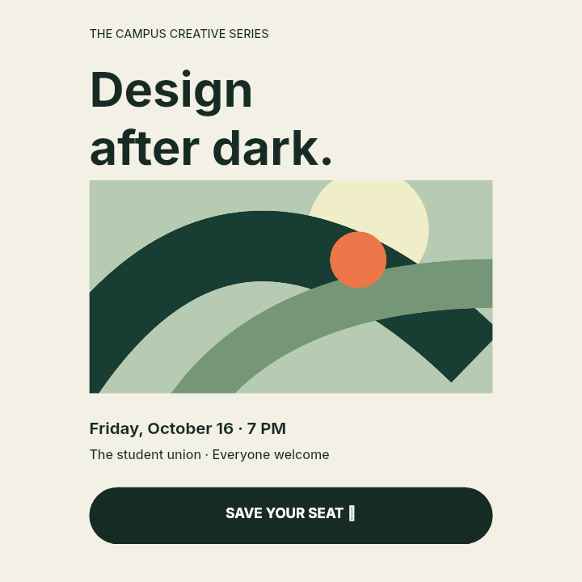 |  |
| [SVG](images/after-dark.svg) · [JSON](designs/after-dark.json) | [SVG](images/after-dark-square-baseline.svg) · [JSON](designs/after-dark-square-baseline.json) | [SVG](images/after-dark-square-selected.svg) · [JSON](designs/after-dark-square-selected.json) |

Baseline: 0 errors / 3 warnings. Selected: 0 errors / 0 warnings.

## Design after dark — Story

1080 × 1920 · strategy: **stack** · layout/checks: 37.8 ms

| Original | Uniform baseline | Selected layout |
| --- | --- | --- |
|  |  | 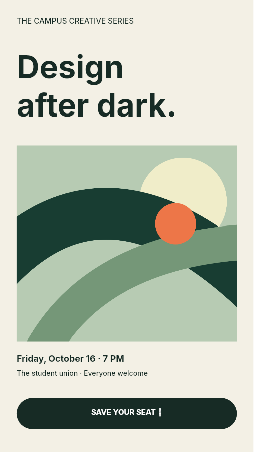 |
| [SVG](images/after-dark.svg) · [JSON](designs/after-dark.json) | [SVG](images/after-dark-story-baseline.svg) · [JSON](designs/after-dark-story-baseline.json) | [SVG](images/after-dark-story-selected.svg) · [JSON](designs/after-dark-story-selected.json) |

Baseline: 0 errors / 0 warnings. Selected: 0 errors / 0 warnings.

## Design after dark — Landscape

1920 × 1080 · strategy: **split** · layout/checks: 38.5 ms

| Original | Uniform baseline | Selected layout |
| --- | --- | --- |
|  | 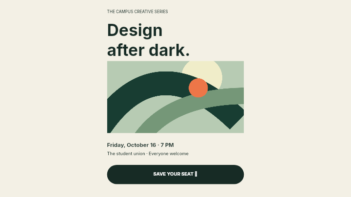 | 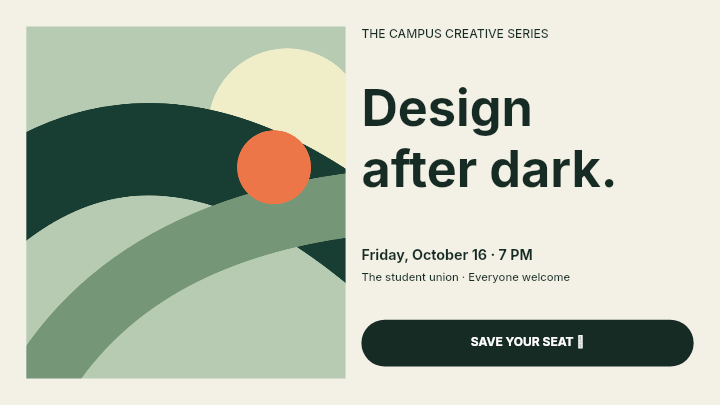 |
| [SVG](images/after-dark.svg) · [JSON](designs/after-dark.json) | [SVG](images/after-dark-landscape-baseline.svg) · [JSON](designs/after-dark-landscape-baseline.json) | [SVG](images/after-dark-landscape-selected.svg) · [JSON](designs/after-dark-landscape-selected.json) |

Baseline: 0 errors / 3 warnings. Selected: 0 errors / 0 warnings.

## A headline with more to say — Square

1080 × 1080 · strategy: **split** · layout/checks: 69.5 ms

| Original | Uniform baseline | Selected layout |
| --- | --- | --- |
| 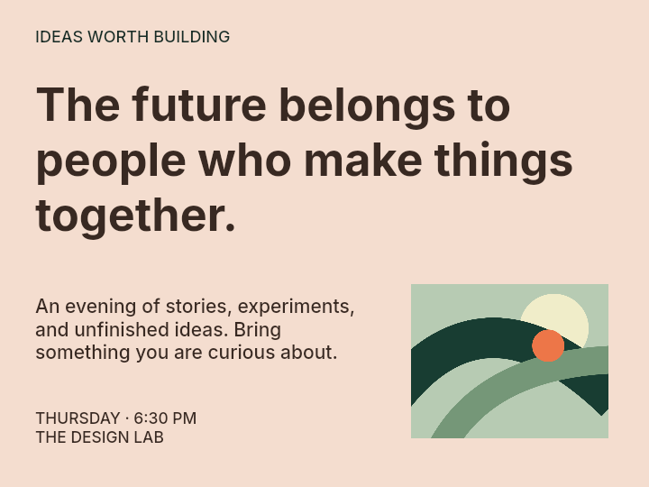 |  |  |
| [SVG](images/long-headline.svg) · [JSON](designs/long-headline.json) | [SVG](images/long-headline-square-baseline.svg) · [JSON](designs/long-headline-square-baseline.json) | [SVG](images/long-headline-square-selected.svg) · [JSON](designs/long-headline-square-selected.json) |

Baseline: 0 errors / 1 warnings. Selected: 0 errors / 0 warnings.

## A headline with more to say — Story

1080 × 1920 · strategy: **stack** · layout/checks: 103.7 ms

| Original | Uniform baseline | Selected layout |
| --- | --- | --- |
|  |  | 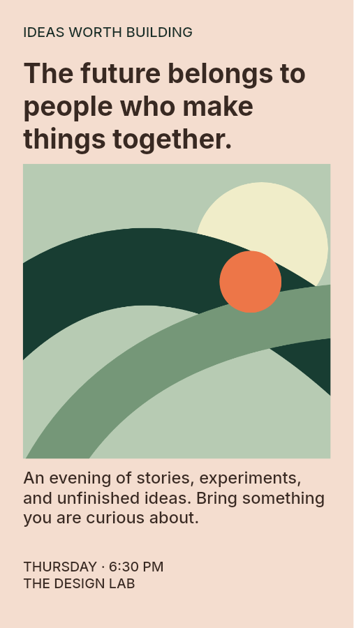 |
| [SVG](images/long-headline.svg) · [JSON](designs/long-headline.json) | [SVG](images/long-headline-story-baseline.svg) · [JSON](designs/long-headline-story-baseline.json) | [SVG](images/long-headline-story-selected.svg) · [JSON](designs/long-headline-story-selected.json) |

Baseline: 0 errors / 1 warnings. Selected: 0 errors / 0 warnings.

## A headline with more to say — Landscape

1920 × 1080 · strategy: **split** · layout/checks: 58.7 ms

| Original | Uniform baseline | Selected layout |
| --- | --- | --- |
|  | 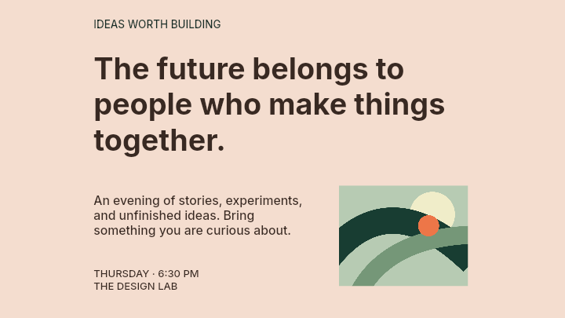 | 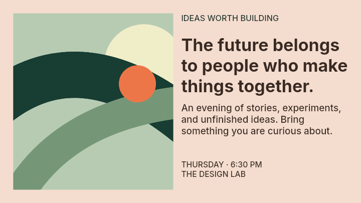 |
| [SVG](images/long-headline.svg) · [JSON](designs/long-headline.json) | [SVG](images/long-headline-landscape-baseline.svg) · [JSON](designs/long-headline-landscape-baseline.json) | [SVG](images/long-headline-landscape-selected.svg) · [JSON](designs/long-headline-landscape-selected.json) |

Baseline: 0 errors / 0 warnings. Selected: 0 errors / 0 warnings.

## A full evening — Square

1080 × 1080 · strategy: **stack** · layout/checks: 85.3 ms

| Original | Uniform baseline | Selected layout |
| --- | --- | --- |
| 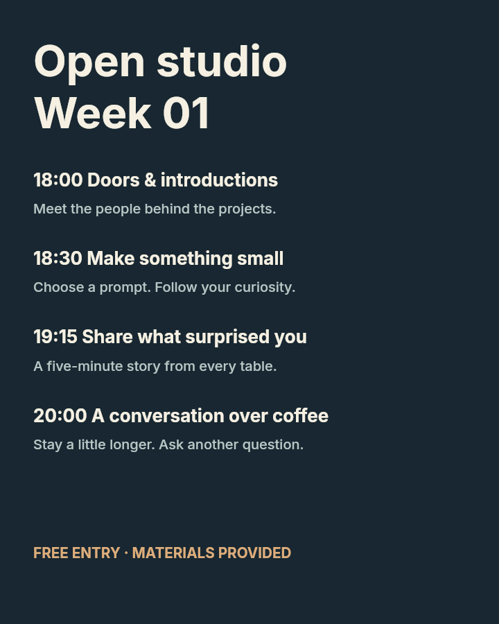 | 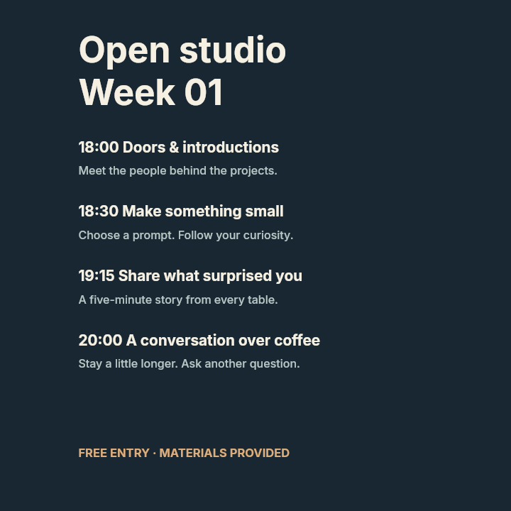 | 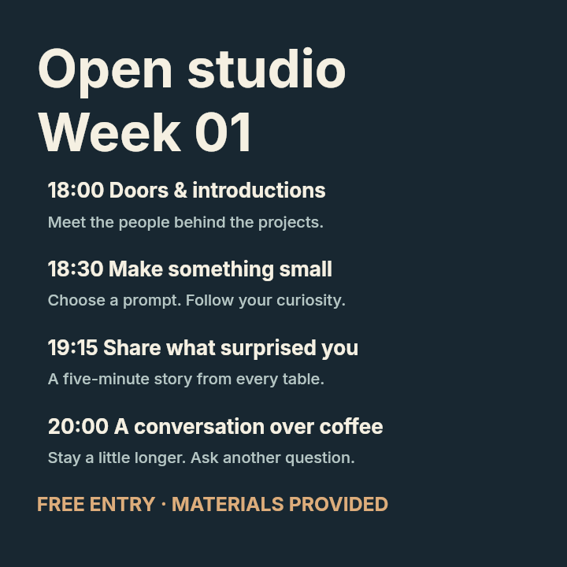 |
| [SVG](images/dense-program.svg) · [JSON](designs/dense-program.json) | [SVG](images/dense-program-square-baseline.svg) · [JSON](designs/dense-program-square-baseline.json) | [SVG](images/dense-program-square-selected.svg) · [JSON](designs/dense-program-square-selected.json) |

Baseline: 0 errors / 5 warnings. Selected: 0 errors / 0 warnings.

## A full evening — Story

1080 × 1920 · strategy: **stack** · layout/checks: 78.2 ms

| Original | Uniform baseline | Selected layout |
| --- | --- | --- |
|  | 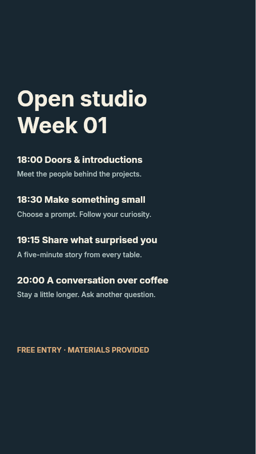 | 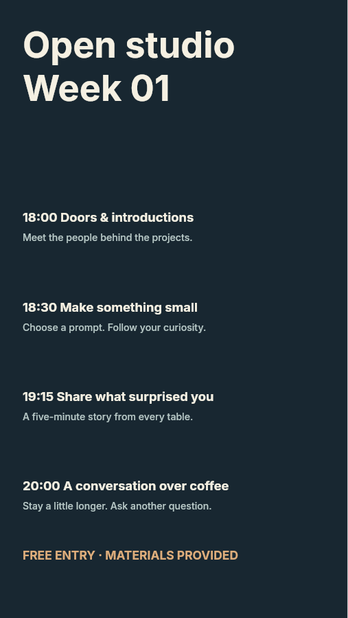 |
| [SVG](images/dense-program.svg) · [JSON](designs/dense-program.json) | [SVG](images/dense-program-story-baseline.svg) · [JSON](designs/dense-program-story-baseline.json) | [SVG](images/dense-program-story-selected.svg) · [JSON](designs/dense-program-story-selected.json) |

Baseline: 0 errors / 0 warnings. Selected: 0 errors / 0 warnings.

## A full evening — Landscape

1920 × 1080 · strategy: **stack** · layout/checks: 81.0 ms

| Original | Uniform baseline | Selected layout |
| --- | --- | --- |
|  | 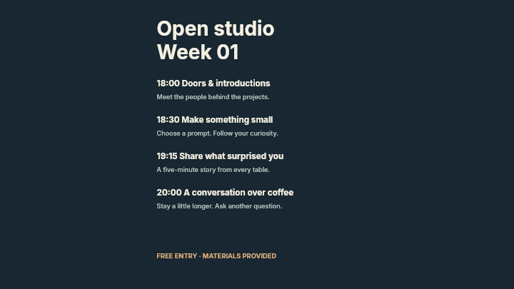 | 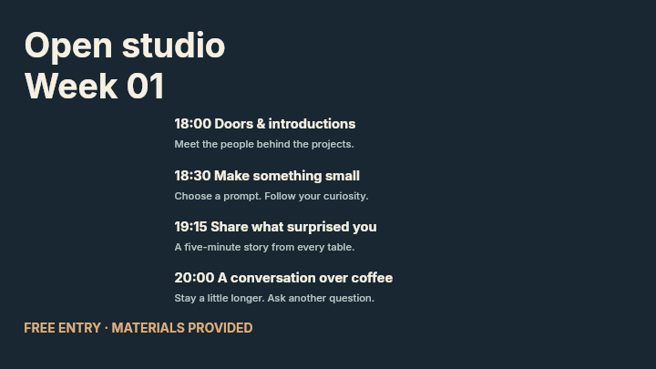 |
| [SVG](images/dense-program.svg) · [JSON](designs/dense-program.json) | [SVG](images/dense-program-landscape-baseline.svg) · [JSON](designs/dense-program-landscape-baseline.json) | [SVG](images/dense-program-landscape-selected.svg) · [JSON](designs/dense-program-landscape-selected.json) |

Baseline: 0 errors / 5 warnings. Selected: 0 errors / 0 warnings.

## Keep the details together — Square

1080 × 1080 · strategy: **uniform** · layout/checks: 36.2 ms

| Original | Uniform baseline | Selected layout |
| --- | --- | --- |
| 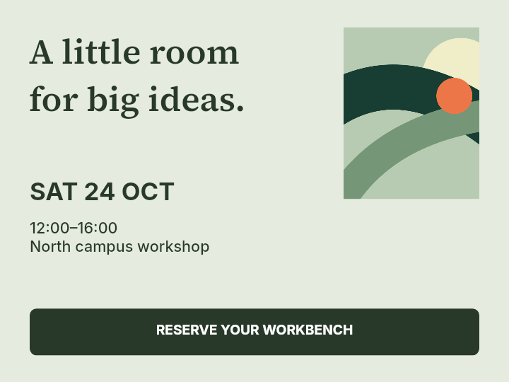 |  |  |
| [SVG](images/grouped-details.svg) · [JSON](designs/grouped-details.json) | [SVG](images/grouped-details-square-baseline.svg) · [JSON](designs/grouped-details-square-baseline.json) | [SVG](images/grouped-details-square-selected.svg) · [JSON](designs/grouped-details-square-selected.json) |

Baseline: 0 errors / 0 warnings. Selected: 0 errors / 0 warnings.

## Keep the details together — Story

1080 × 1920 · strategy: **stack** · layout/checks: 41.5 ms

| Original | Uniform baseline | Selected layout |
| --- | --- | --- |
|  |  | 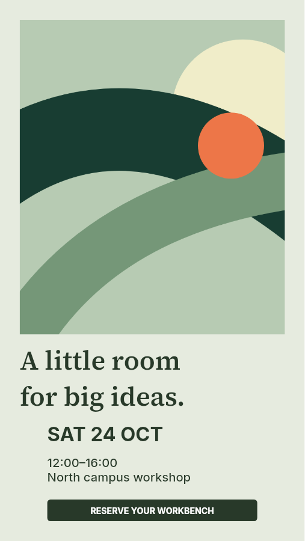 |
| [SVG](images/grouped-details.svg) · [JSON](designs/grouped-details.json) | [SVG](images/grouped-details-story-baseline.svg) · [JSON](designs/grouped-details-story-baseline.json) | [SVG](images/grouped-details-story-selected.svg) · [JSON](designs/grouped-details-story-selected.json) |

Baseline: 0 errors / 0 warnings. Selected: 0 errors / 0 warnings.

## Keep the details together — Landscape

1920 × 1080 · strategy: **uniform** · layout/checks: 70.9 ms

| Original | Uniform baseline | Selected layout |
| --- | --- | --- |
|  |  | 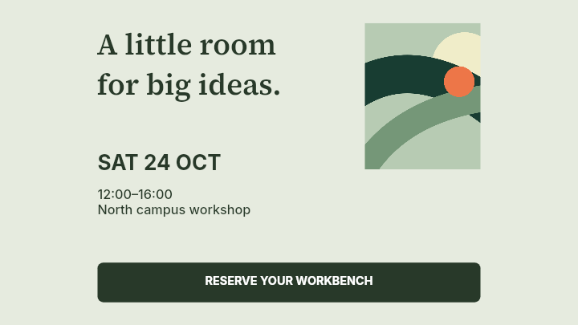 |
| [SVG](images/grouped-details.svg) · [JSON](designs/grouped-details.json) | [SVG](images/grouped-details-landscape-baseline.svg) · [JSON](designs/grouped-details-landscape-baseline.json) | [SVG](images/grouped-details-landscape-selected.svg) · [JSON](designs/grouped-details-landscape-selected.json) |

Baseline: 0 errors / 0 warnings. Selected: 0 errors / 0 warnings.

## Designed to overlap — Square

1080 × 1080 · strategy: **stack** · layout/checks: 59.4 ms

| Original | Uniform baseline | Selected layout |
| --- | --- | --- |
| 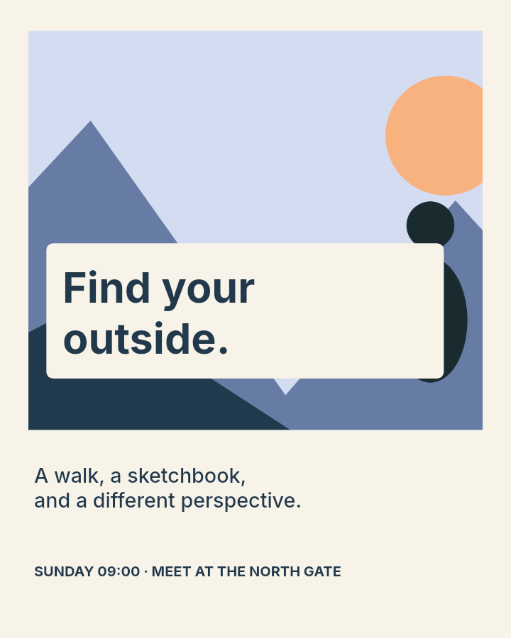 | 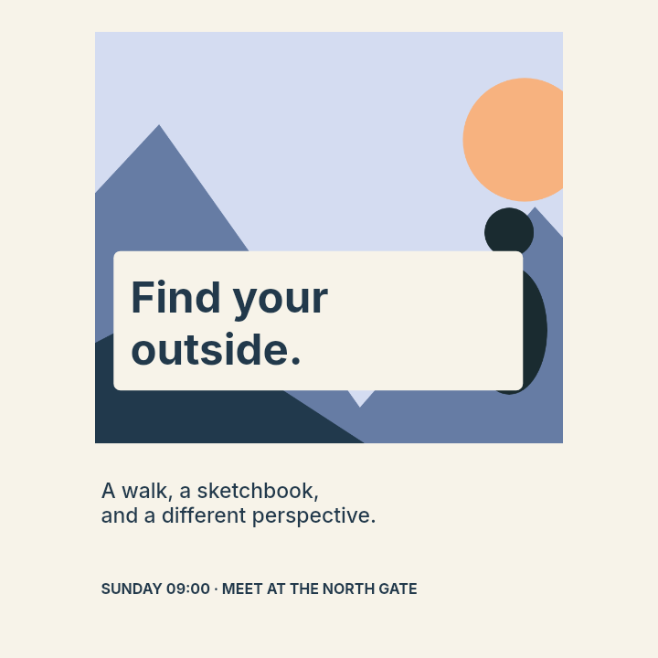 | 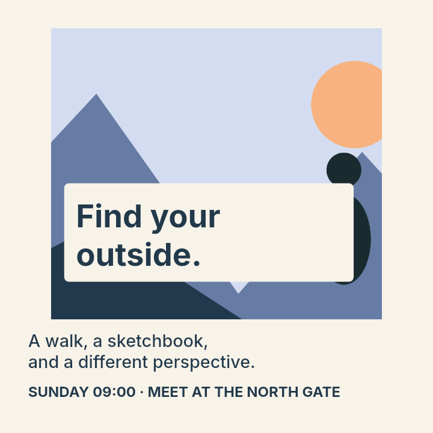 |
| [SVG](images/intentional-overlap.svg) · [JSON](designs/intentional-overlap.json) | [SVG](images/intentional-overlap-square-baseline.svg) · [JSON](designs/intentional-overlap-square-baseline.json) | [SVG](images/intentional-overlap-square-selected.svg) · [JSON](designs/intentional-overlap-square-selected.json) |

Baseline: 0 errors / 1 warnings. Selected: 0 errors / 0 warnings.

## Designed to overlap — Story

1080 × 1920 · strategy: **stack** · layout/checks: 41.9 ms

| Original | Uniform baseline | Selected layout |
| --- | --- | --- |
|  | 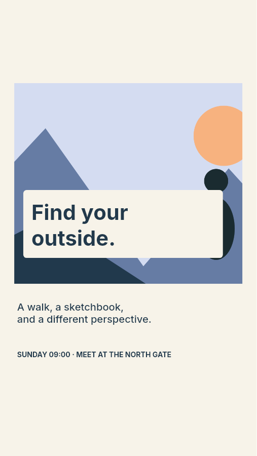 | 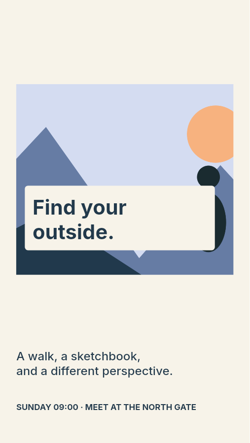 |
| [SVG](images/intentional-overlap.svg) · [JSON](designs/intentional-overlap.json) | [SVG](images/intentional-overlap-story-baseline.svg) · [JSON](designs/intentional-overlap-story-baseline.json) | [SVG](images/intentional-overlap-story-selected.svg) · [JSON](designs/intentional-overlap-story-selected.json) |

Baseline: 0 errors / 0 warnings. Selected: 0 errors / 0 warnings.

## Designed to overlap — Landscape

1920 × 1080 · strategy: **split** · layout/checks: 32.5 ms

| Original | Uniform baseline | Selected layout |
| --- | --- | --- |
|  | 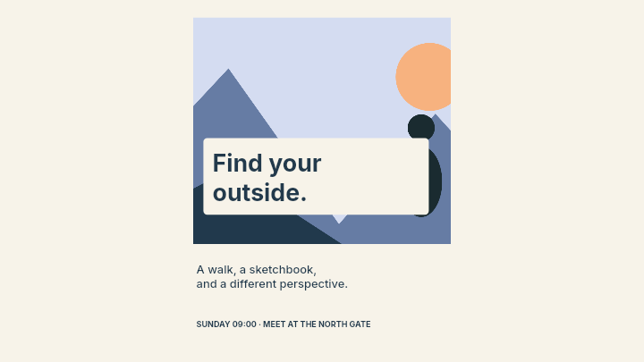 | 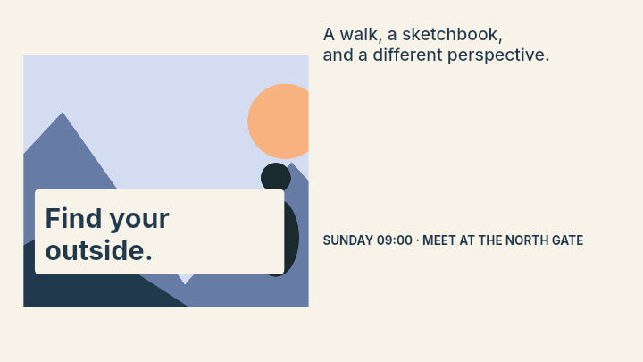 |
| [SVG](images/intentional-overlap.svg) · [JSON](designs/intentional-overlap.json) | [SVG](images/intentional-overlap-landscape-baseline.svg) · [JSON](designs/intentional-overlap-landscape-baseline.json) | [SVG](images/intentional-overlap-landscape-selected.svg) · [JSON](designs/intentional-overlap-landscape-selected.json) |

Baseline: 0 errors / 1 warnings. Selected: 0 errors / 0 warnings.

## Layers of possibility — Square

1080 × 1080 · strategy: **identity** · layout/checks: 0.9 ms

| Original | Uniform baseline | Selected layout |
| --- | --- | --- |
| 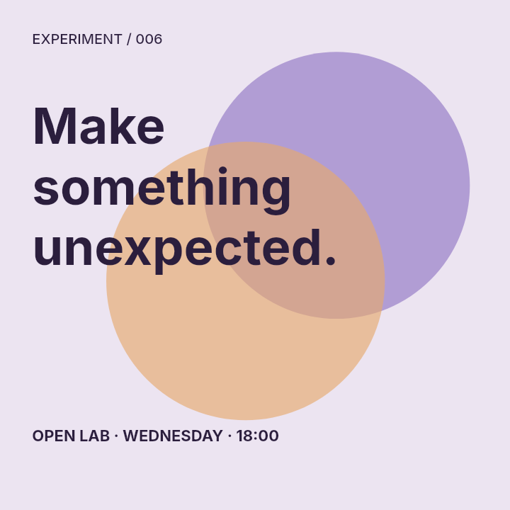 |  |  |
| [SVG](images/layered-art.svg) · [JSON](designs/layered-art.json) | [SVG](images/layered-art-square-baseline.svg) · [JSON](designs/layered-art-square-baseline.json) | [SVG](images/layered-art-square-selected.svg) · [JSON](designs/layered-art-square-selected.json) |

Baseline: 0 errors / 0 warnings. Selected: 0 errors / 0 warnings.

## Layers of possibility — Story

1080 × 1920 · strategy: **stack** · layout/checks: 22.6 ms

| Original | Uniform baseline | Selected layout |
| --- | --- | --- |
|  |  | 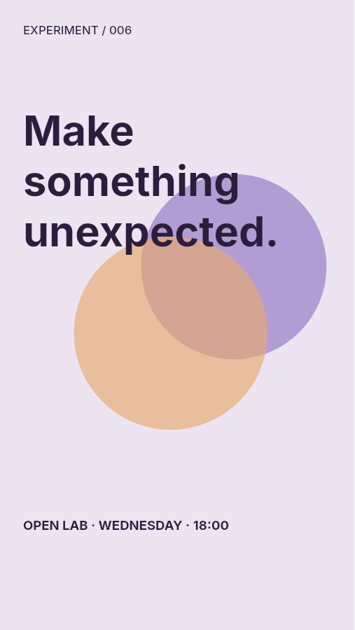 |
| [SVG](images/layered-art.svg) · [JSON](designs/layered-art.json) | [SVG](images/layered-art-story-baseline.svg) · [JSON](designs/layered-art-story-baseline.json) | [SVG](images/layered-art-story-selected.svg) · [JSON](designs/layered-art-story-selected.json) |

Baseline: 0 errors / 0 warnings. Selected: 0 errors / 0 warnings.

## Layers of possibility — Landscape

1920 × 1080 · strategy: **stack** · layout/checks: 19.0 ms

| Original | Uniform baseline | Selected layout |
| --- | --- | --- |
|  | 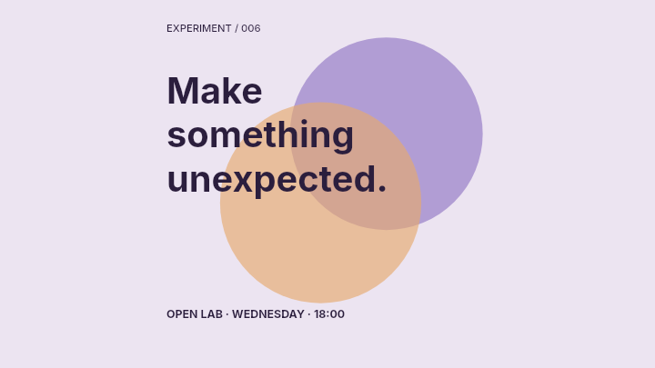 | 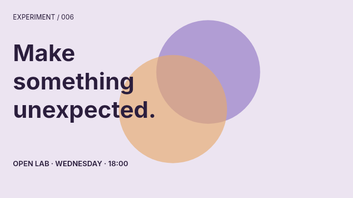 |
| [SVG](images/layered-art.svg) · [JSON](designs/layered-art.json) | [SVG](images/layered-art-landscape-baseline.svg) · [JSON](designs/layered-art-landscape-baseline.json) | [SVG](images/layered-art-landscape-selected.svg) · [JSON](designs/layered-art-landscape-selected.json) |

Baseline: 0 errors / 0 warnings. Selected: 0 errors / 0 warnings.

## Small batch, good things — Square

1080 × 1080 · strategy: **split** · layout/checks: 50.5 ms

| Original | Uniform baseline | Selected layout |
| --- | --- | --- |
| 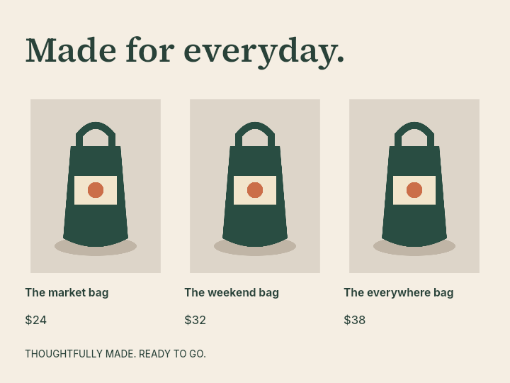 | 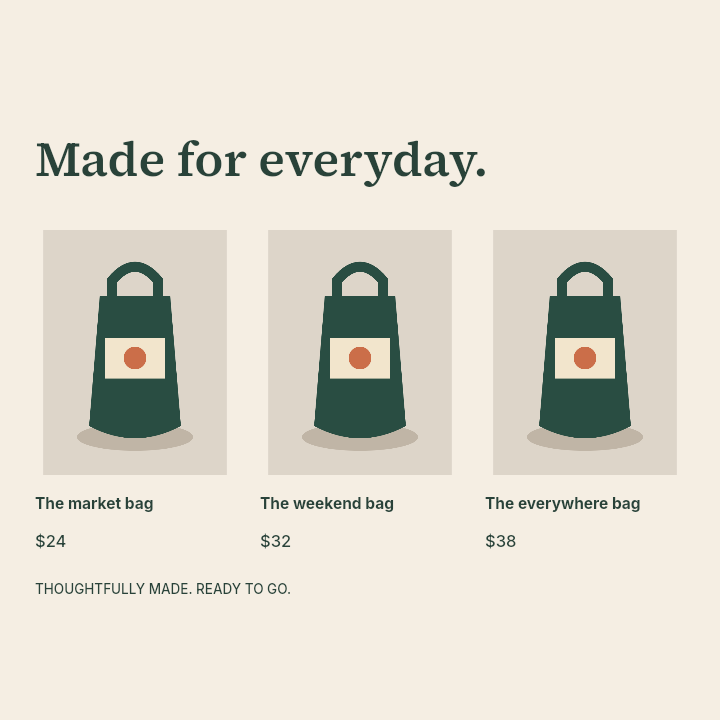 | 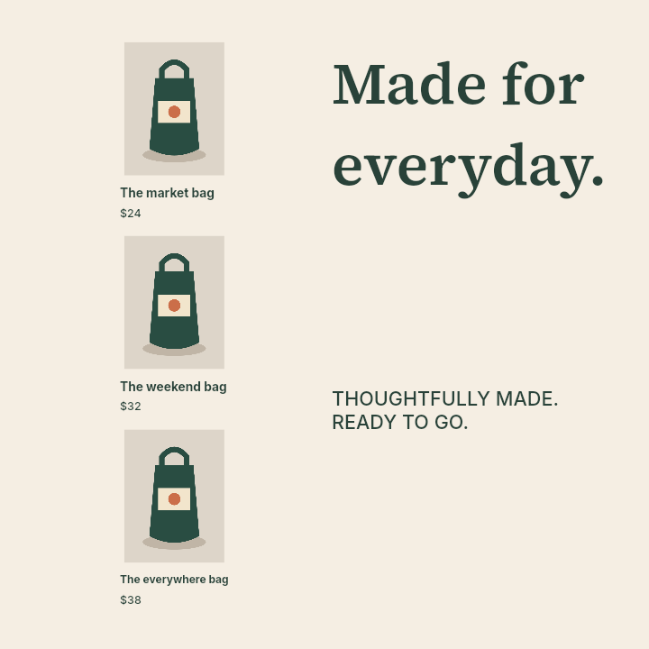 |
| [SVG](images/product-pairs.svg) · [JSON](designs/product-pairs.json) | [SVG](images/product-pairs-square-baseline.svg) · [JSON](designs/product-pairs-square-baseline.json) | [SVG](images/product-pairs-square-selected.svg) · [JSON](designs/product-pairs-square-selected.json) |

Baseline: 0 errors / 7 warnings. Selected: 0 errors / 6 warnings.

- **warning**: label-0 reads at 6.9px on a 360px short edge.
- **warning**: price-0 reads at 6.2px on a 360px short edge.
- **warning**: label-1 reads at 6.9px on a 360px short edge.
- **warning**: price-1 reads at 6.2px on a 360px short edge.
- **warning**: label-2 reads at 6.0px on a 360px short edge.
- **warning**: price-2 reads at 6.2px on a 360px short edge.

## Small batch, good things — Story

1080 × 1920 · strategy: **split** · layout/checks: 44.1 ms

| Original | Uniform baseline | Selected layout |
| --- | --- | --- |
|  | 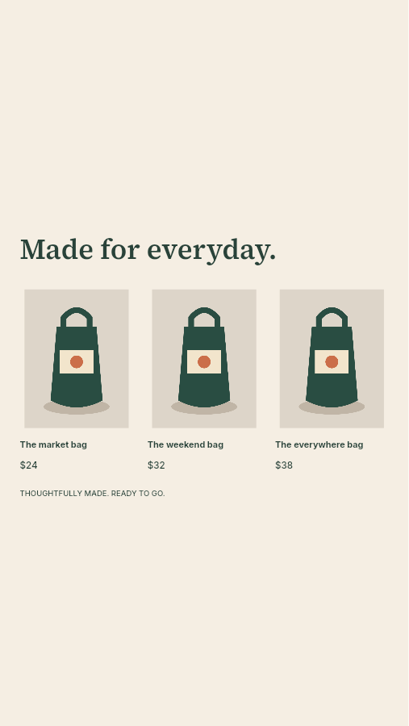 |  |
| [SVG](images/product-pairs.svg) · [JSON](designs/product-pairs.json) | [SVG](images/product-pairs-story-baseline.svg) · [JSON](designs/product-pairs-story-baseline.json) | [SVG](images/product-pairs-story-selected.svg) · [JSON](designs/product-pairs-story-selected.json) |

Baseline: 0 errors / 7 warnings. Selected: 0 errors / 0 warnings.

## Small batch, good things — Landscape

1920 × 1080 · strategy: **uniform** · layout/checks: 42.7 ms

| Original | Uniform baseline | Selected layout |
| --- | --- | --- |
|  |  | 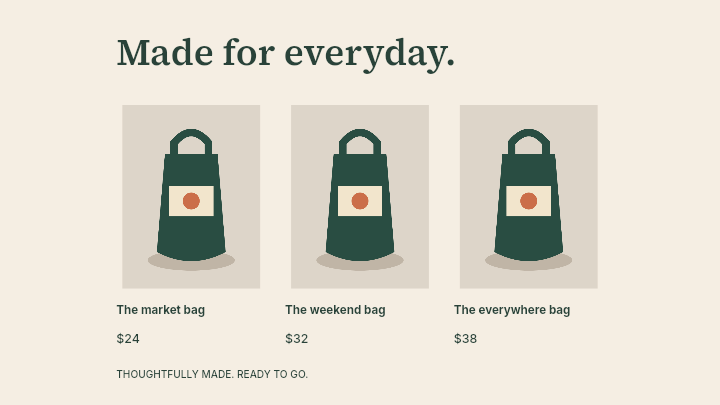 |
| [SVG](images/product-pairs.svg) · [JSON](designs/product-pairs.json) | [SVG](images/product-pairs-landscape-baseline.svg) · [JSON](designs/product-pairs-landscape-baseline.json) | [SVG](images/product-pairs-landscape-selected.svg) · [JSON](designs/product-pairs-landscape-selected.json) |

Baseline: 0 errors / 0 warnings. Selected: 0 errors / 0 warnings.

## Room to breathe — Square

1080 × 1080 · strategy: **stack** · layout/checks: 47.6 ms

| Original | Uniform baseline | Selected layout |
| --- | --- | --- |
| 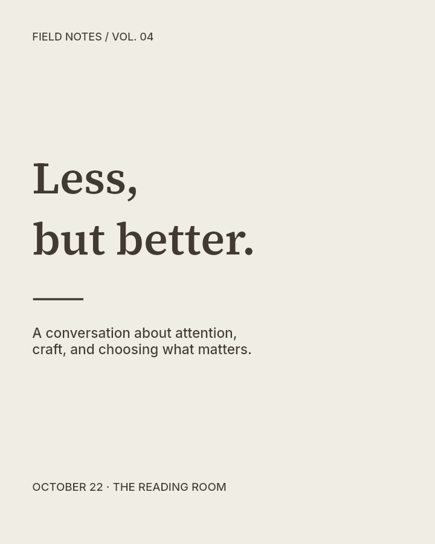 | 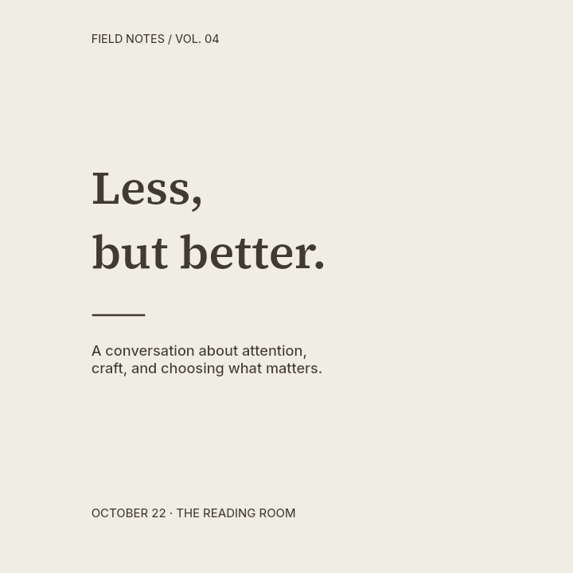 |  |
| [SVG](images/quiet-brand.svg) · [JSON](designs/quiet-brand.json) | [SVG](images/quiet-brand-square-baseline.svg) · [JSON](designs/quiet-brand-square-baseline.json) | [SVG](images/quiet-brand-square-selected.svg) · [JSON](designs/quiet-brand-square-selected.json) |

Baseline: 0 errors / 2 warnings. Selected: 0 errors / 0 warnings.

## Room to breathe — Story

1080 × 1920 · strategy: **stack** · layout/checks: 40.8 ms

| Original | Uniform baseline | Selected layout |
| --- | --- | --- |
|  |  | 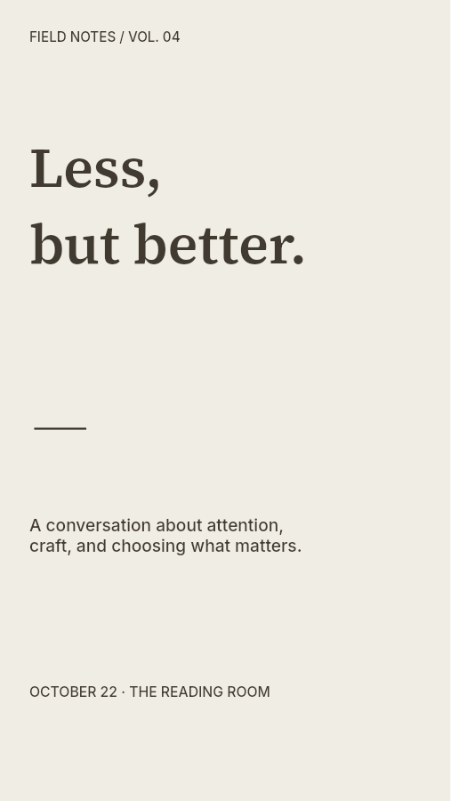 |
| [SVG](images/quiet-brand.svg) · [JSON](designs/quiet-brand.json) | [SVG](images/quiet-brand-story-baseline.svg) · [JSON](designs/quiet-brand-story-baseline.json) | [SVG](images/quiet-brand-story-selected.svg) · [JSON](designs/quiet-brand-story-selected.json) |

Baseline: 0 errors / 0 warnings. Selected: 0 errors / 0 warnings.

## Room to breathe — Landscape

1920 × 1080 · strategy: **stack** · layout/checks: 36.8 ms

| Original | Uniform baseline | Selected layout |
| --- | --- | --- |
|  | 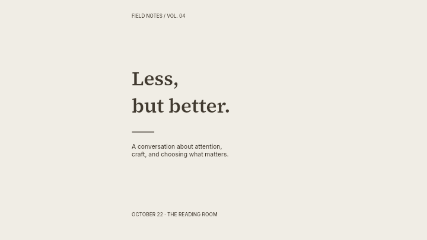 |  |
| [SVG](images/quiet-brand.svg) · [JSON](designs/quiet-brand.json) | [SVG](images/quiet-brand-landscape-baseline.svg) · [JSON](designs/quiet-brand-landscape-baseline.json) | [SVG](images/quiet-brand-landscape-selected.svg) · [JSON](designs/quiet-brand-landscape-selected.json) |

Baseline: 0 errors / 2 warnings. Selected: 0 errors / 0 warnings.

## Keep the subject in view — Square

1080 × 1080 · strategy: **stack** · layout/checks: 20.6 ms

| Original | Uniform baseline | Selected layout |
| --- | --- | --- |
| 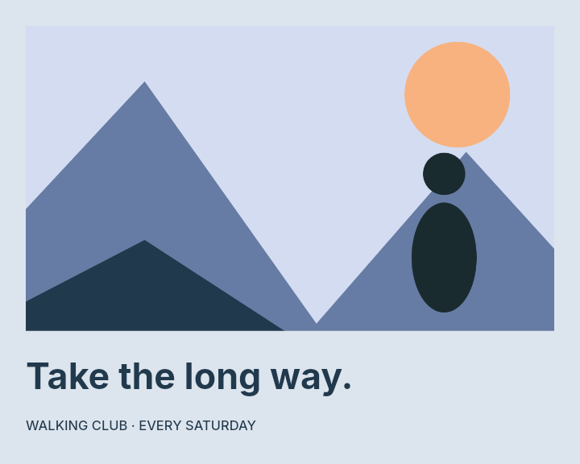 | 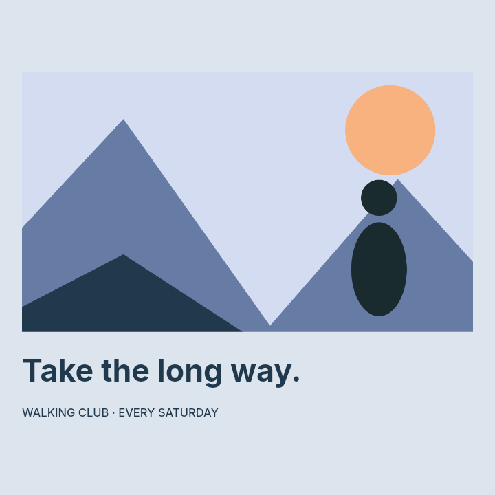 | 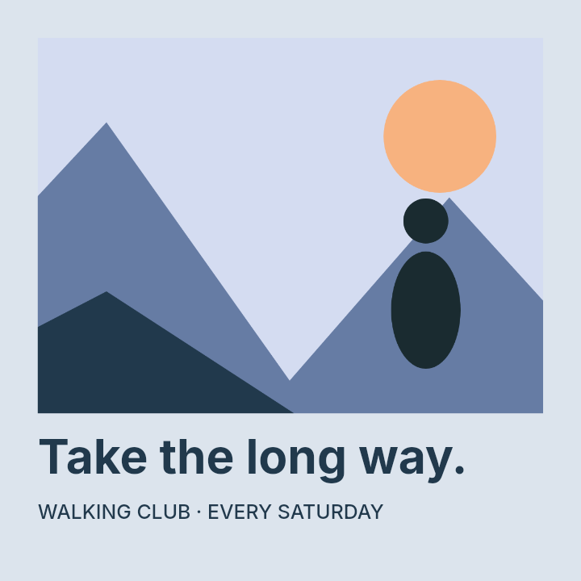 |
| [SVG](images/edge-subject.svg) · [JSON](designs/edge-subject.json) | [SVG](images/edge-subject-square-baseline.svg) · [JSON](designs/edge-subject-square-baseline.json) | [SVG](images/edge-subject-square-selected.svg) · [JSON](designs/edge-subject-square-selected.json) |

Baseline: 0 errors / 1 warnings. Selected: 0 errors / 0 warnings.

## Keep the subject in view — Story

1080 × 1920 · strategy: **stack** · layout/checks: 16.0 ms

| Original | Uniform baseline | Selected layout |
| --- | --- | --- |
|  | 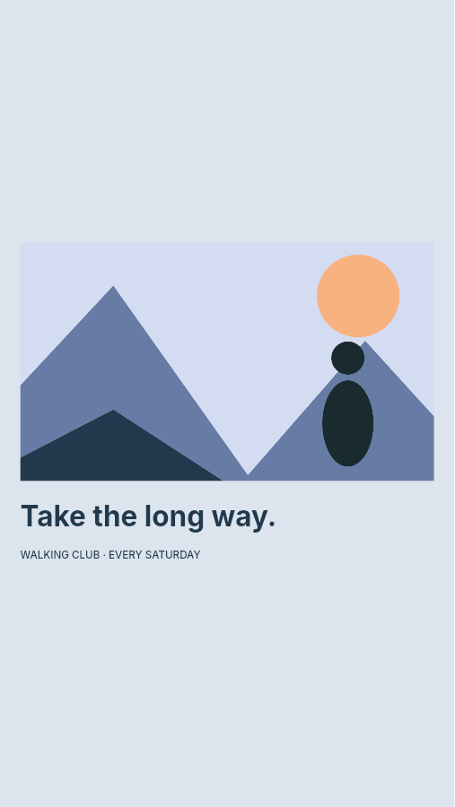 | 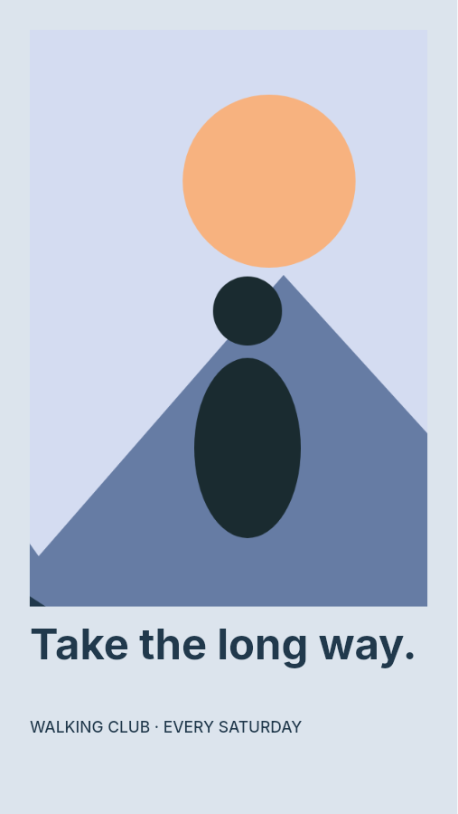 |
| [SVG](images/edge-subject.svg) · [JSON](designs/edge-subject.json) | [SVG](images/edge-subject-story-baseline.svg) · [JSON](designs/edge-subject-story-baseline.json) | [SVG](images/edge-subject-story-selected.svg) · [JSON](designs/edge-subject-story-selected.json) |

Baseline: 0 errors / 1 warnings. Selected: 0 errors / 0 warnings.

## Keep the subject in view — Landscape

1920 × 1080 · strategy: **split** · layout/checks: 14.0 ms

| Original | Uniform baseline | Selected layout |
| --- | --- | --- |
|  |  | 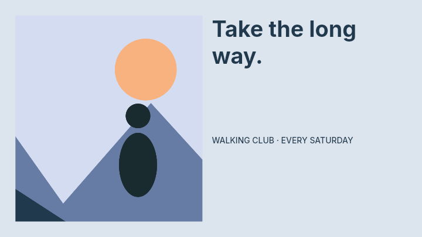 |
| [SVG](images/edge-subject.svg) · [JSON](designs/edge-subject.json) | [SVG](images/edge-subject-landscape-baseline.svg) · [JSON](designs/edge-subject-landscape-baseline.json) | [SVG](images/edge-subject-landscape-selected.svg) · [JSON](designs/edge-subject-landscape-selected.json) |

Baseline: 0 errors / 0 warnings. Selected: 0 errors / 0 warnings.

## Two voices, one design — Square

1080 × 1080 · strategy: **stack** · layout/checks: 44.1 ms

| Original | Uniform baseline | Selected layout |
| --- | --- | --- |
| 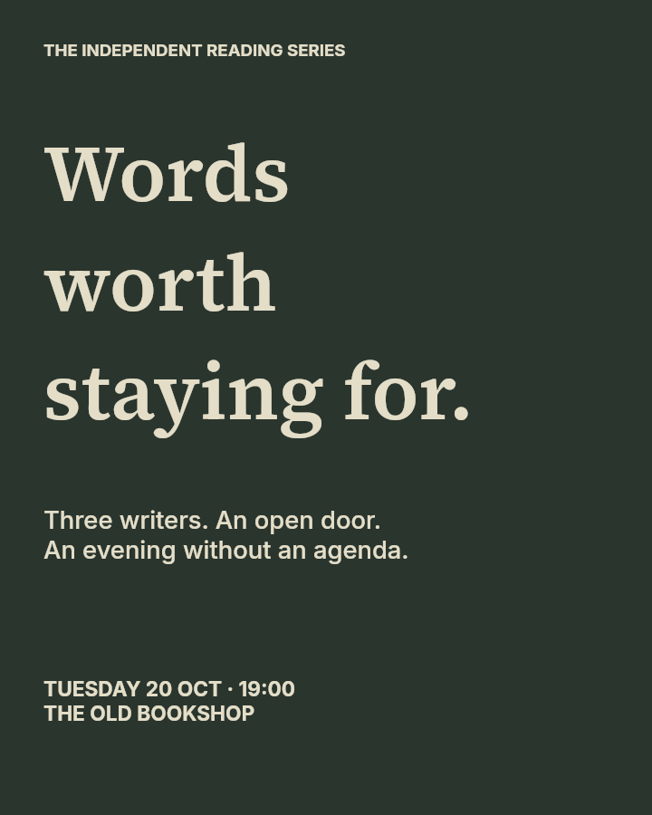 |  |  |
| [SVG](images/type-pairing.svg) · [JSON](designs/type-pairing.json) | [SVG](images/type-pairing-square-baseline.svg) · [JSON](designs/type-pairing-square-baseline.json) | [SVG](images/type-pairing-square-selected.svg) · [JSON](designs/type-pairing-square-selected.json) |

Baseline: 0 errors / 1 warnings. Selected: 0 errors / 0 warnings.

## Two voices, one design — Story

1080 × 1920 · strategy: **stack** · layout/checks: 40.0 ms

| Original | Uniform baseline | Selected layout |
| --- | --- | --- |
|  |  |  |
| [SVG](images/type-pairing.svg) · [JSON](designs/type-pairing.json) | [SVG](images/type-pairing-story-baseline.svg) · [JSON](designs/type-pairing-story-baseline.json) | [SVG](images/type-pairing-story-selected.svg) · [JSON](designs/type-pairing-story-selected.json) |

Baseline: 0 errors / 0 warnings. Selected: 0 errors / 0 warnings.

## Two voices, one design — Landscape

1920 × 1080 · strategy: **stack** · layout/checks: 40.9 ms

| Original | Uniform baseline | Selected layout |
| --- | --- | --- |
|  | 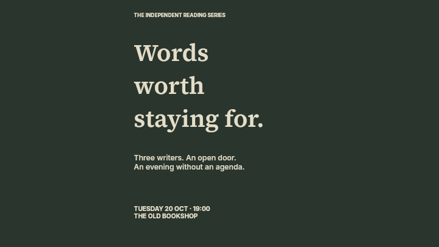 |  |
| [SVG](images/type-pairing.svg) · [JSON](designs/type-pairing.json) | [SVG](images/type-pairing-landscape-baseline.svg) · [JSON](designs/type-pairing-landscape-baseline.json) | [SVG](images/type-pairing-landscape-selected.svg) · [JSON](designs/type-pairing-landscape-selected.json) |

Baseline: 0 errors / 1 warnings. Selected: 0 errors / 0 warnings.
