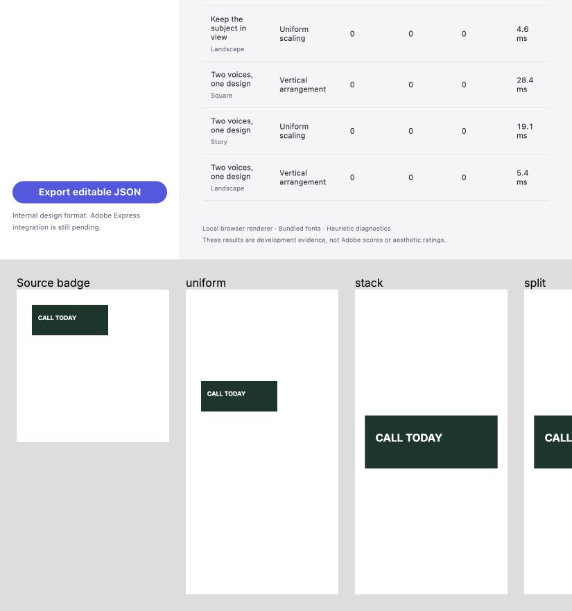

# CI regression gates — September 16, 2026 (UTC)

Issue [#13](https://github.com/ojedaJD/reflow-studio/issues/13) now runs the supported engine checks on direct pushes to main. Implementation: [`56757a7`](https://github.com/ojedaJD/reflow-studio/commit/56757a720ca97b3a87a0ac04b2ef22ab2ff56750). See the [plan](../../plans/ci-regression-gates.md), [workflow](../../../.github/workflows/ci.yml), and [reproduction guide](../../ci.md).

## Evidence

The pre-change suite passed **153/153** as characterization: production layout behavior was not changed. Seven new report-contract tests bring the final suite to **160/160**. Locked install, build, all **30 native cases**, and benchmark export pass locally and in the first hosted run.

| Hosted run at the same implementation commit | Result | Evidence |
| --- | --- | --- |
| [Push to main, #1](https://github.com/ojedaJD/reflow-studio/actions/runs/35056343493) | Passed; 1m 2s total | Locked install, tests/build, native/benchmark, real Chromium acceptance and artifact upload |
| [Injected badge separation, #2](https://github.com/ojedaJD/reflow-studio/actions/runs/35056385226) | Expected failure; 51s total | Real glyph assertion failed; browser command exit 1; [failure artifact](https://github.com/ojedaJD/reflow-studio/actions/runs/35056385226/artifacts/10430986564) |
| [Fault removed, #3](https://github.com/ojedaJD/reflow-studio/actions/runs/35056493606) | Passed; 58s total | Same engine and workflow, manual input restored to `none`; [passing artifact](https://github.com/ojedaJD/reflow-studio/actions/runs/35056493606/artifacts/10430324696) |

The negative control moved the actual rendered label outside its dark backing. The failed assertion was `uniform: actual glyph bounds separated from the dark backing`. It did not force an exit code. The hosted log records a failed screenshot, error context and trace, followed by successful upload of **229 files / 12,357,512 ZIP bytes**. Artifact SHA-256: `dd23188d2fb1463075f74be24b7d37bd69d1a8039db38fa62c757bf81c1e64f8`.

The [browser failure log](hosted-negative-browser.txt) and [upload log](hosted-negative-upload.txt) were captured from the rendered GitHub job logs. The artifact is retained for **14 days**. Its ZIP contents were not independently extracted in this session; use the linked artifact for complete hosted JSON, images and trace. These archived log extracts remain after artifact expiration.

The restored passing run uploaded **226 files / 11,635,276 ZIP bytes**; see its [passing browser log](hosted-positive-browser.txt), [upload log](hosted-positive-upload.txt) and [Linux runtime metadata](hosted-environment.txt).

## Local red and green controls

- [Injected report](local-browser-red.json): **10/11**, failed real badge glyph bounds; [report validator exits 1](local-gate-red.txt).
- [Healthy report](local-browser-green.json): **11/11**, no errors or ink findings; [report validator exits 0](local-gate-green.txt).
- [Local environment](local-environment.json): Node 24.20.0, Playwright 1.63.0, Inter/Source Serif 4 packages 5.3.0, native canvas 1.0.9, provisional schema `reflow.design.v0`, and lockfile hash. Its commit is null because it was generated outside Actions; hosted metadata records the commit.

The connected local browser was Chrome 152; CI installs Playwright's pinned Chromium headless shell. The desktop's separate headless launch was denied by the Mach-port sandbox. That infrastructure failure is excluded from behavioral red evidence; the hosted specification actually executed in Chromium.

Inspected both local fault states visually. In the failing state the source label remained visible and the moved white label disappeared on white. The reviewed healthy viewport below shows visible source/uniform/stack labels; the split preview is partially outside this viewport and is covered by the glyph assertion.

## Scope and remaining work

CI protects existing content/style/order/group mutations, malformed inputs, coherent groups, nearby source stability, and ID/scale/group-order/intentional-overlap controls. It rejects empty, incomplete, duplicate, failed and contradictory browser reports. External job, step and test timeouts are configured; a hard runner cancellation can still prevent artifact upload.

This is a synthetic development corpus. Browser glyph bounds and native badge pixels provide rendered checks; selector diagnostics and PNG signatures alone do not establish visibility or aesthetic quality. General contrast/occlusion/crops, independent quality review (#7), offline engine/container bounds (#8), and official Adobe rendering (#4) remain separate work. The conditional #8/#4 checks must be wired into CI when those interfaces exist. No PR or reviewer requirement was added; optional branches remain `jo/`.

Skill assessment: existing verification/browser skills and the repository's checked-in CI guide cover this repeatable procedure. No additional skill was created.
