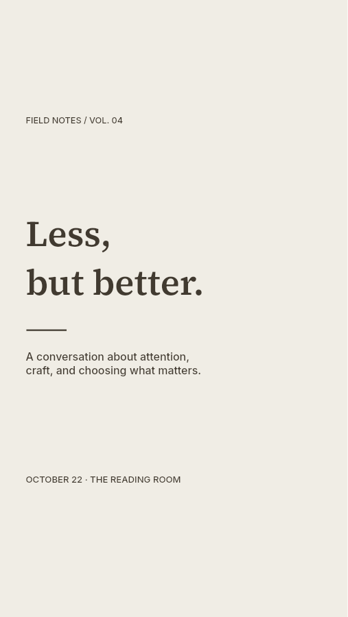
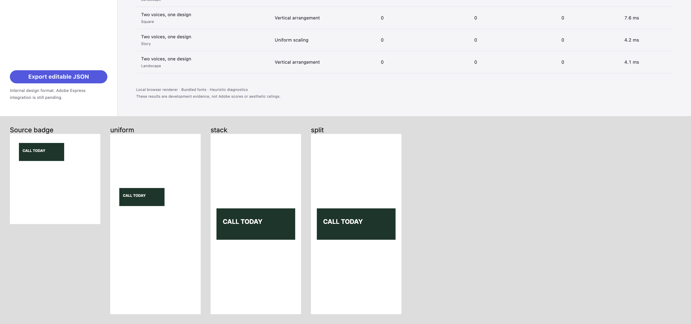

# Measurement and equivalent-arrangement reuse — September 16, 2026

Reviewed evidence for a bounded **slice of [#8](https://github.com/ojedaJD/reflow-studio/issues/8)**. The offline CLI/container, execution deadlines, cancellation/fallback, official limits and teammate reproduction remain open. #3 has no font-parity handoff; this engine-only slice preserves the existing typography and document interfaces. [Plan and execution record](../../plans/measurement-cache.md) · [measurement contract](../../design-contract.md#measurement-reuse).

## Change and test-first evidence

Reflow now caches repeated queries within each immutable element context for one call, retaining at most 4,096 entries / 262,144 UTF-16 query code units. It also reuses completed stack work when split would follow the identical path. Both public candidate entries remain independent copies, with their original strategies and findings. This is a cache retention bound, not an execution deadline or process memory bound.

The [behavioral red log](red.txt) records two expected failures on `0757de5`: 36 repeated font requests and 85 repeated equivalent-arrangement contexts. Three controls passed. [Focused green](green.txt) passes 18 tests, including cache capacity/eviction, oversized/empty/Unicode inputs, stale-font isolation, copied metric values, invalid metrics, exceptions and valid mixed image/text splitting. [All 178 tests](tests.txt), [build](build.txt), [30 native cases](verify.txt) and [benchmark](benchmark.txt) pass.

Implementation commit [`90bc454`](https://github.com/ojedaJD/reflow-studio/commit/90bc454dca9da3cd8bec563718faa928332f82a1) passed [hosted CI](https://github.com/ojedaJD/reflow-studio/actions/runs/35092538387): install, tests/build, native verification/benchmark, real Chromium acceptance and evidence retention all completed successfully. The [reviewed job/browser excerpt](hosted-ci.txt) includes the passing real-browser assertion. CI retains its full reports for 14 days; this directory preserves local reviewed evidence. The initial notes-only `0757de5` run also [passed](https://github.com/ojedaJD/reflow-studio/actions/runs/35090889429).

## Rendered and diagnostic evidence

- [Browser report](browser.json): 11/11 checks, zero startup errors or glyph-bound findings, with the actual connected Chrome version recorded. The saved report passed the same completeness assertion used by CI. The browser's console buffer was empty; Vite forwarded ordinary Spectrum/Lit development-mode warnings. This local evidence does not claim a local headless Playwright run.
- [Byte comparison](benchmark-comparison.json): **all 70 editable documents and 70 PNGs** match the prior archived output. Selected references are the [source-ranking archive](../2026-09-16-source-ranking/README.md); original/baseline references are the [September 15 archive](../2026-09-15/README.md).
- Geometry/content errors stay at zero; baseline/selected warnings stay **42 / 11**. Cache reuse does not repair those warnings or prove visual quality. The serif, dense, product and sparse previews below were inspected; the small product text and deliberate whitespace remain visible limitations. Browser badge text stays on its backing.

| Reviewed output | Preview |
| --- | --- |
| Serif pairing / square |  |
| Dense program / landscape |  |
| Products / square, existing readability warnings |  |
| Sparse brand / story |  |
| Browser badge, all candidates |  |

## Runtime observations

The [final comparison](runtime.json) uses Apple M1 / macOS arm64 / Node 24.20.0 with the same native fonts in one process. Thirty fixture/target pairs receive one warmup per engine, then three alternating paired rounds; each dense size receives one alternating pair. **All 94 complete results match**, excluding only elapsed time. Layout validation, fitting, diagnostics and selection are timed; font loading, parsing and rendering are excluded.

| Workload | Previous native calls | Current native calls | Previous time | Current time |
| --- | ---: | ---: | ---: | ---: |
| 90 fixture pairs (totals; median time) | 112,050 | 70,260 | 65.46 ms | 49.58 ms |
| 1 dense element | 4,653 | 2,270 | 0.412 s | 0.186 s |
| 10 dense elements | 46,530 | 22,700 | 6.091 s | 2.879 s |
| 40 dense elements | 186,120 | 90,800 | 20.476 s | 13.885 s |
| 100 dense elements | 465,300 | 227,000 | 30.864 s | 15.180 s |

This is the combined effect of caching and equivalent-arrangement reuse, not an isolated attribution to either mechanism. Every dense case still reports one small-text warning per element (100 in the largest case); none is hidden. [The first run](runtime-first.json) also matched all 94 pairs with the same call counts, but overlapped initial verification processes during fixture sampling: fixture medians were 32.36 / 24.98 ms and dense-100 was 31.768 / 15.880 s. The repeat ran without this task's other verification processes; desktop load was not controlled. The variation is why these samples do **not** establish typical latency, p95, a speed guarantee or a deadline. CPU/memory limits, cold start, parsing, peak RSS and full export profiling still belong to the remaining #8 harness.

## Reproduction and remaining scope

```sh
npm ci --cache .cache/npm
npm test
npm run build
npm run verify
npm run benchmark
npm run review:measurements
npm run dev
# Visit /verify.html in a browser.
```

`review:measurements` requires base commit `0757de5fe5b50c175cd00b2ec15add414c85de8d` in local Git history. It imports that engine with unchanged dependencies, asserts complete result equality excluding `elapsedMs`, and writes fresh observations under ignored `reports/measurement-cache/`. The archived [pre-change profile](profile-before.json) includes instrumented native timing and repeated-request counts; its [source](profile-before.txt) ran from `reports/measurement-cache/` on that base. Native fonts are the existing bundled Latin Inter 400/500/600/700 and Source Serif 4 600, using `@napi-rs/canvas` 1.0.9 and Node 24.20.0.

#8 remains open for actual bounded execution and offline delivery, with full font behavior still dependent on #3 and the official contract on #4. #5 product/typography work, #12 larger transitions/visibility and #7 independent quality remain separate. No changes to typography, rendering, fixtures, browser checks or document/result signatures were made. Existing verification skills, repo instructions and the new comparison script cover this repeatable process; no new skill was warranted.
