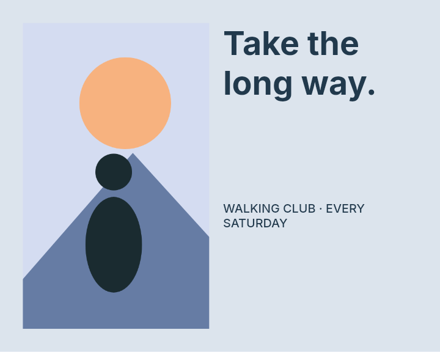

# Source-aware ranking — September 16

Engine implementation for the nearby-composition portion of [issue #12](https://github.com/ojedaJD/reflow-studio/issues/12), based on `920f6fc2928e048d63c92688c8614c7076aa8971`. See the [test-first plan](../../plans/source-aware-ranking.md) and [selection policy](../../design-contract.md#source-aware-selection).

The new selector keeps existing hard diagnostics first, stops rewarding text growth beyond readability, and balances the worst squared reading deficit against movement, source alignment, pair spacing, relative prominence, and cover-frame aspect change. The composition penalty relaxes continuously as target and source aspect ratios diverge. Candidate generation, protected content, fonts, renderers, and shared document/metric contracts are unchanged.

## Results and regression categories

The sweep covered **2,422 distinct dimensions/design cases** across ten original and three additional authored designs. There are 182 nearby observations: 156 non-identity ±1/2/8px axis changes and 26 identity observations (identity is sampled on both axes). All 13 sources have zero native errors.

| Measure | Previous selector | Current selector | Composition penalty removed |
| --- | ---: | ---: | ---: |
| Nearby stack/split selections | 132 | **0** | 12 |
| Maximum nearby normalized center movement | 0.5760 | **0.00444** | 0.09071 |
| Maximum nearby cover-frame crop-risk proxy | 0.6515 | < 1e-15 | 0.09575 |
| Errors across original 30 outputs | 0 | **0** | 0 |
| Readability warnings across original 30 | 6 | **11** | 7 |
| Errors / warnings across additional nine outputs | 0 / 0 | **0 / 0** | 0 / 0 |

Movement compares element centers in each canvas's normalized coordinates. Crop risk measures frame-aspect change, **not lost image pixels or subject visibility**. The ablation removes only the weighted composition term, retaining the same continuous reading deficit and deterministic tie break. It shows that both removing unlimited font rewards and adding composition preferences contribute; stability cannot be attributed solely to the new geometry terms.

The five added warnings are explicit tradeoffs, not hidden by lower thresholds: long-headline square/story retain 8.7px minimum reading size, edge-subject square/story retain 8.27px, and product-pairs square has seven warnings instead of six. In that last case the worst size improves from 6.01px to 6.75px while one additional text element falls below 9px. Product layout remains unresolved in #5. The 30 selections are now 1 identity / 18 uniform / 10 stack / 1 split, versus 1 / 3 / 19 / 7. See [all 30 before/after comparisons](gallery.md), [full benchmark](benchmark.json), and [summary with per-case changes](summary.json).

## Visible observations and transition limits

The nearby edge-subject preview retains the wide image and title below it instead of becoming a split composition. Sparse quiet-brand preserves its source spacing and decoration, with more letterboxing in the tall format. These are developer observations, not independent human preferences.

| Edge-subject source | Previous after +1px width | Current after +1px width |
| --- | --- | --- |
|  |  |  |

The sweep records **19 actual layout-family transitions**; identity/uniform changes alone do not count. Every integer in each detected coarse transition bracket was inspected numerically. This does not prove there are no additional switches inside coarse intervals with matching endpoint strategies.

- After-dark at 1163→1164px width switches uniform→stack: minimum reading size changes 8.36→10.00px, with 0.04275 maximum normalized adjacent movement. [Before](images/transition-after-dark-width-1164-before-current.png) / [after](images/transition-after-dark-width-1164-after-current.png).
- The largest observed jump is still product-pairs at 936→937px width: split→uniform, approximately **0.6104** maximum normalized movement. [Before](images/product-transition-936.png) / [after](images/product-transition-937.png). Source relationships and all content survive, but this is a substantial discrete switch. The complete decisions and ranking terms are in `summary.json` and the two corresponding `designs/product-transition-*.json` files.
- Visual inspection rejected an intermediate implementation that left gallery-diptych as a tiny strip in a tall story. A native-font regression was added before the aspect-aware change; the [final story](images/story-gallery-diptych-current.png) now selects a readable stack. The deterministic mock measurer did not reproduce this failure; bundled native fonts did.
- The museum-sidebar story still has awkward whitespace and a small image in its split candidate. [Previous](images/story-museum-sidebar-previous.png) / [current](images/story-museum-sidebar-current.png). Better candidates/spacing and independent quality evaluation remain necessary.
- Native ticket previews show the existing arrow-glyph limitation. Clean bounds and preserved copy do not establish full glyph coverage; typography/rendering work remains #3.

The three additional designs were authored before implementation but promoted to development regressions after inspection. **They are not held-out evaluation.** Issue #12 remains open for independent held-out/human evidence with #7, broader transition quality with #5, and actual visibility/crop diagnostics with #6. None of those is a PR/reviewer gate for landing this tested engine increment.

## Test-first and runtime evidence

- Initial regression run: [9 failed / 4 passed](red.txt). Extended source-relation checks: [10 failed / 5 passed](ranking-red.txt). The native tall-gallery regression then reproduced [1 failed / 18 passed](aspect-red.txt) before its production change.
- Final [153 tests](final-test.txt), [TypeScript/build](final-build.txt), [30 native verification cases](final-verify.txt), [benchmark](final-benchmark.txt), and [11/11 browser checks](browser-green.json) pass. Browser checks include nearby dimensions with real browser fonts, selected SVG glyph bounds, grouped badge visibility, editable export, and startup errors. No browser error or glyph-bound finding was recorded. Adversarial [probe output](final-probes.txt) remains separately reported.
- [Paired runtime comparison](runtime.json): one warmup per engine/case, then three rounds alternating order. Every generated candidate and diagnostic was exactly equal in all 117 previous/current pairs, isolating ranking. Original cases: median **32.42→32.97ms**, p95 **73.39→72.50ms**; additional cases: median **21.39→21.67ms**, p95 **36.63→33.53ms**. This is a local observation with noise, not a speedup or enforced budget. Full sweep/one-shot benchmark timings are also saved and should not be mixed with this paired protocol.

## Reproduction and files

```sh
npm ci
npm test
npm run build
npm run verify
npm run benchmark
npm run review:stability
npm run review:stability-runtime
npm run review:probes
CHOKIDAR_USEPOLLING=true npm run dev -- --port 5174 --strictPort
```

Visit `/verify.html` for browser acceptance. The polling option avoids stale local Vite modules observed in this workspace. Stop the dev server before paired runtime measurement. Use an available port if 5174 is occupied.

- `summary.json`: method, all transitions, source checks, aggregate results, and visual case names.
- `sweep.json.gz`: full 2,488 observations, including repeated samples and every candidate's metrics/ranking terms. Decompress with `gzip -dc` to inspect; distinct case count is 2,422.
- `benchmark.json`, `gallery.md`, `images/`, `designs/`: all 30 selected editable outputs and native PNGs, plus the representative comparisons above. Original/baseline/previous images remain in the September 15 archive.
- `extra-preview.ts.txt`: exact product-transition inspection helper; copy to `reports/stability/extra-preview.ts` and run with `npx tsx` to regenerate its two cases.
- `manifest.json`: SHA-256 checksums for this reviewed snapshot.

Skill assessment: existing verification/browser skills, repository workflow instructions, and the new reproducible sweep commands cover this procedure. No new skill was created.
