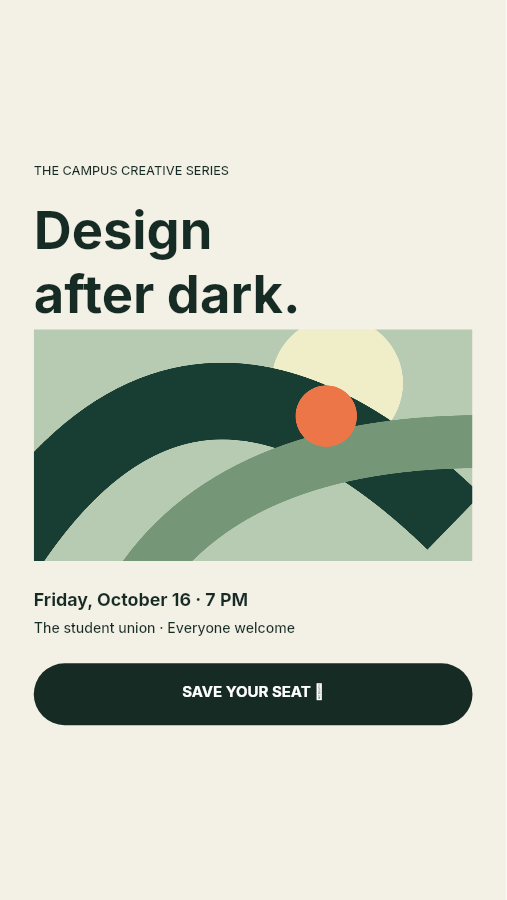
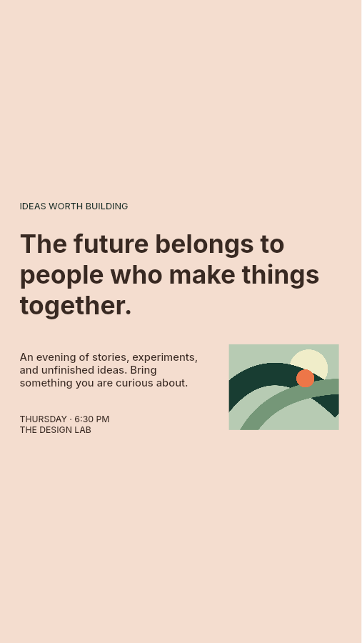
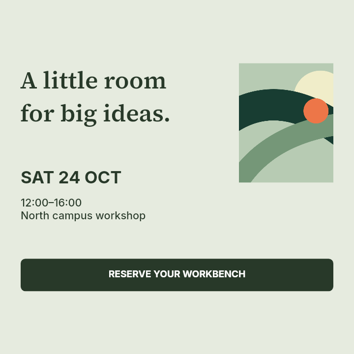
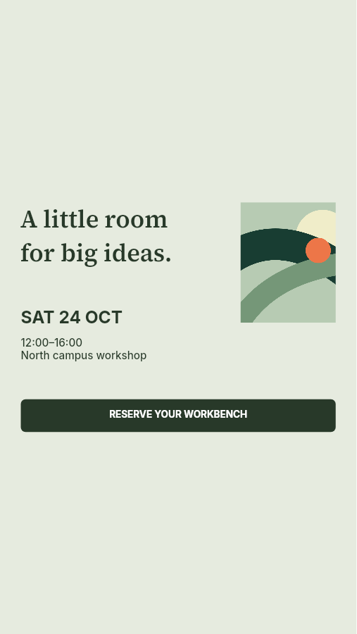
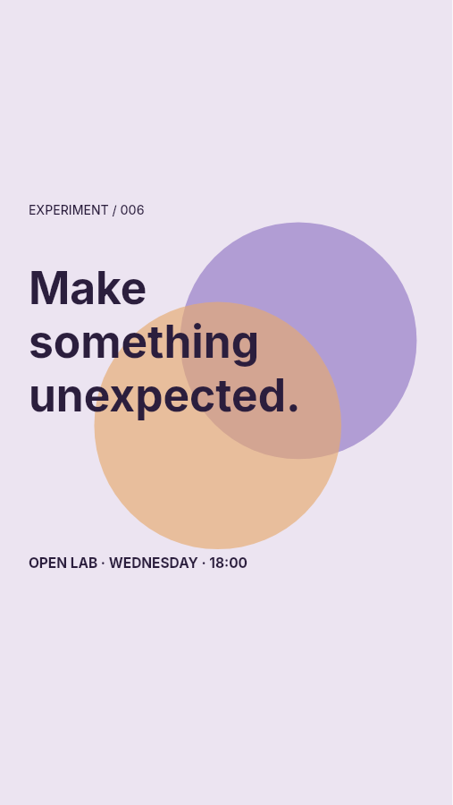
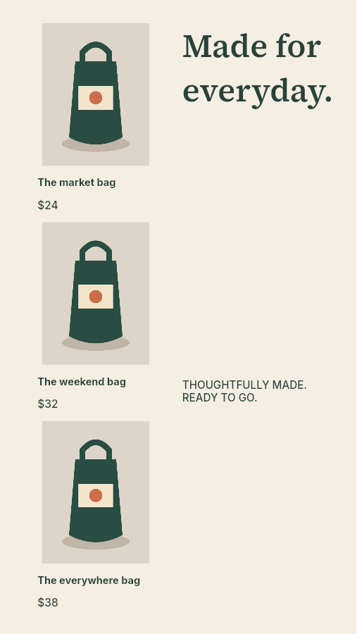
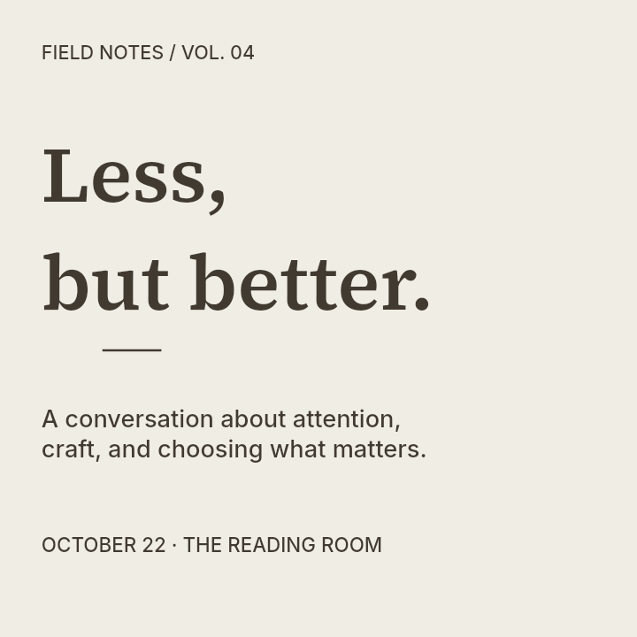

# All 30 outputs after source-aware ranking

Source, uniform baseline, and previous selected images link to the unchanged September 15 archive. Current editable output links below; every candidate is in [benchmark.json](benchmark.json). These are native engineering previews, not Adobe or independent quality scores.

| Design / target | Source | Baseline | Previous selection | Current selection |
| --- | --- | --- | --- | --- |
| after-dark / square |  |  |  |  [stack JSON](designs/after-dark-square-selected.json) |
| after-dark / story |  |  |  |  [uniform JSON](designs/after-dark-story-selected.json) |
| after-dark / landscape |  |  |  |  [stack JSON](designs/after-dark-landscape-selected.json) |
| long-headline / square |  |  |  |  [uniform JSON](designs/long-headline-square-selected.json) |
| long-headline / story |  |  |  |  [uniform JSON](designs/long-headline-story-selected.json) |
| long-headline / landscape |  |  |  |  [uniform JSON](designs/long-headline-landscape-selected.json) |
| dense-program / square |  |  |  |  [stack JSON](designs/dense-program-square-selected.json) |
| dense-program / story |  |  |  |  [uniform JSON](designs/dense-program-story-selected.json) |
| dense-program / landscape |  |  |  |  [stack JSON](designs/dense-program-landscape-selected.json) |
| grouped-details / square |  |  |  |  [uniform JSON](designs/grouped-details-square-selected.json) |
| grouped-details / story |  |  |  |  [uniform JSON](designs/grouped-details-story-selected.json) |
| grouped-details / landscape |  |  |  |  [uniform JSON](designs/grouped-details-landscape-selected.json) |
| intentional-overlap / square |  |  |  |  [stack JSON](designs/intentional-overlap-square-selected.json) |
| intentional-overlap / story |  |  |  |  [uniform JSON](designs/intentional-overlap-story-selected.json) |
| intentional-overlap / landscape |  |  |  |  [stack JSON](designs/intentional-overlap-landscape-selected.json) |
| layered-art / square |  |  |  |  [identity JSON](designs/layered-art-square-selected.json) |
| layered-art / story |  |  |  |  [uniform JSON](designs/layered-art-story-selected.json) |
| layered-art / landscape |  |  |  |  [uniform JSON](designs/layered-art-landscape-selected.json) |
| product-pairs / square |  |  |  |  [uniform JSON](designs/product-pairs-square-selected.json) |
| product-pairs / story |  |  |  |  [split JSON](designs/product-pairs-story-selected.json) |
| product-pairs / landscape |  |  |  |  [uniform JSON](designs/product-pairs-landscape-selected.json) |
| quiet-brand / square |  |  |  |  [stack JSON](designs/quiet-brand-square-selected.json) |
| quiet-brand / story |  |  |  |  [uniform JSON](designs/quiet-brand-story-selected.json) |
| quiet-brand / landscape |  |  |  |  [stack JSON](designs/quiet-brand-landscape-selected.json) |
| edge-subject / square |  |  |  |  [uniform JSON](designs/edge-subject-square-selected.json) |
| edge-subject / story |  |  |  |  [uniform JSON](designs/edge-subject-story-selected.json) |
| edge-subject / landscape |  |  |  |  [uniform JSON](designs/edge-subject-landscape-selected.json) |
| type-pairing / square |  |  |  |  [stack JSON](designs/type-pairing-square-selected.json) |
| type-pairing / story |  |  |  |  [uniform JSON](designs/type-pairing-story-selected.json) |
| type-pairing / landscape |  |  |  |  [stack JSON](designs/type-pairing-landscape-selected.json) |
