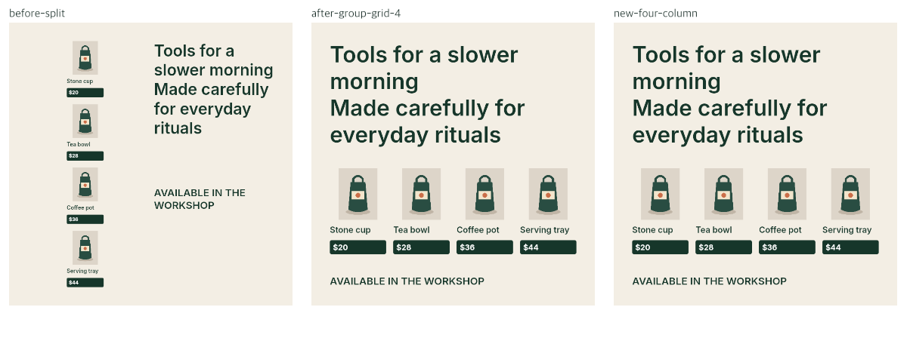

# Readable four-product square row — September 22, 2026

Bounded continuation of issue [#5](https://github.com/kj-squared-labs/reflow-studio/issues/5). [Plan and red/green record](../../plans/four-product-row.md) · [45-case all-candidate comparison, ablation, runtime and source hashes](review.json.gz) · [30-case benchmark](benchmark-results.json.gz). Base: `b4ba15cf5a658003969f41ef4b08b8caa24e19be`.

These are authored development designs, native/Chromium measurements and agent visual observations. They are not blind human preference, independent corpus or Adobe integration evidence.

## Observable change

A valid four-product source with a long headline has four grouped photos, product names, prices and dark price plates. Its source text fits before the product band. On a 1080×1080 target, the previous split selected eight small product names/prices. Existing one-, two- and three-column grids also left all eight small. A single row of four **whole groups** now fits in the available space after measured headline/footer allocation: **8→0 small-text warnings**, zero hard errors. The original copy, assets, font/color styles, group membership and paint order remain intact. White price text stays on its dark backing. No reading threshold or ranker weight changed.

The shorter four-product source changes from a three-plus-one square grid to the four-product row, keeping zero warnings. Agent visual review found a coherent row in both square outputs. On a tall story, the first implementation made photos about 215px wide on a 1080px canvas and left substantial empty space. A visual regression test first failed on that output; the new alternative is now generated only for near-square targets (width/height 0.8–1.25). Story and landscape selections match the previous engine. This ratio is a conservative eligibility boundary, not an aesthetic score.

| Authored case | Before selected | After selected | Warnings, before → after | Hard errors |
| --- | --- | --- | ---: | ---: |
| Four products, long headline / square | split | four-column row | 8 → 0 | 0 → 0 |
| Four products, short headline / square | three-column grid | four-column row | 0 → 0 | 0 → 0 |
| Both four-product sources / story and landscape | Previous strategies | Unchanged | Unchanged | 0 |

The [comparison images](images/four-product-shelf-square-comparison.png) also show the shorter source. The prior three-column output was readable; the new row's selection reflects the existing source-relative ranking, not a validated human preference. The long-headline square fixes a **generation gap**: no prior candidate had readable product text. Removing only `group-grid-4` from the new result restores every prior selection across the 45-case review, so ranking did not change.

## Standard benchmark and runtime

All original ten fixtures × three formats retain their complete previous alternatives and selected designs. The standard benchmark has zero selected hard errors, **seven selected warnings before and after**, and **70/70 editable documents and 70/70 PNGs byte-identical** against the previous engine. The 45-case authored review adds only two candidates, both for square four-product sources; no new grid duplicates. The remaining unreadable fixture cases and the known unsupported arrow warning stay visible.

One warmup per case followed by three paired native rounds with alternating engine order produced:

| Set | Pairs | Previous median | Current median | Native measure calls, previous → current |
| --- | ---: | ---: | ---: | ---: |
| Original 30 targets | 90 | 16.50 ms | 16.36 ms | 80,085 → 80,085 |
| Two four-product sources × three targets | 18 | 48.81 ms | 52.17 ms | 45,738 → 47,868 |

The extra candidate has a measured cost on eligible designs. These local runs exclude PNG rendering and font loading and do not impose a runtime or memory budget. #8 owns that broader execution work.

## Verification and limits

- [Initial red](red.txt): two real 8-warning failures with extreme/invalid/rigid controls passing. [Second red](story-red.txt): narrow 214.65px photo in the tall story, caught after the first square fix and before the eligibility gate.
- **258 tests**, TypeScript/build, all **30 native verification cases**, benchmark and [12/12 browser checks](browser-report.json) pass; all **150 font-parity probes** agree on line breaks. [Browser runtime](browser-runtime.json) is retained.
- Native before/after images for square, story and landscape were inspected. The long-headline square has legible text with preserved hierarchy; the legal white-price/dark-plate overlaps remain visible. Story/landscape output and sparse designs are unchanged by exact comparison. The browser gate covers the workbench and SVG glyph bounds; direct Adobe/native round-trip, manual keyboard/mobile review, and creator usability review remain open.
- The producer script is `npx tsx scripts/four-product-row-review.ts`; it requires the recorded base commit locally and writes fresh output under ignored `reports/four-product-row/`. This archive holds the reviewed summary and representative native images. Final hosted CI on the published commit is linked in the task handoff.

Issue #5 remains open for relationships beyond rigid explicit groups, dense text that cannot fit even with a four-product row, more varied candidate generation and independent ranking/quality evidence. Teammate comparison was not performed in this slice. Existing browser skills and repository review scripts cover the repeatable procedure; no new skill was warranted.

Large JSON archives are stored losslessly as gzip. Read with `gzip -dc review.json.gz` (or `benchmark-results.json.gz`); generated runtime reports still use plain JSON.
