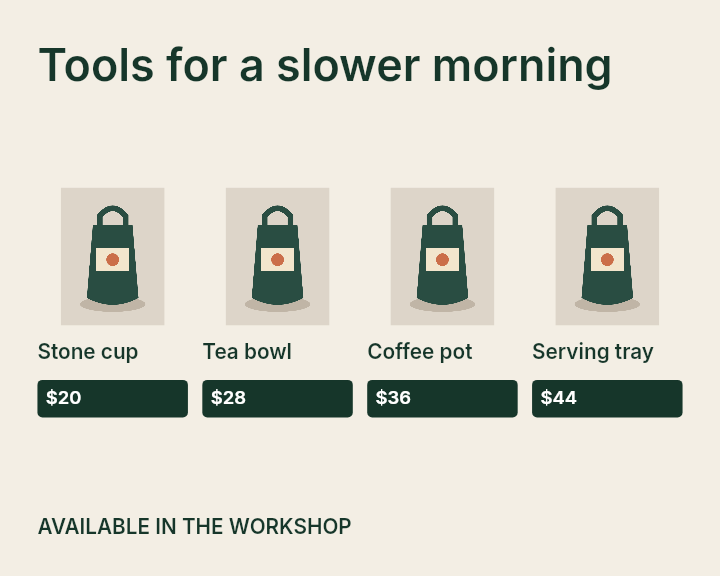
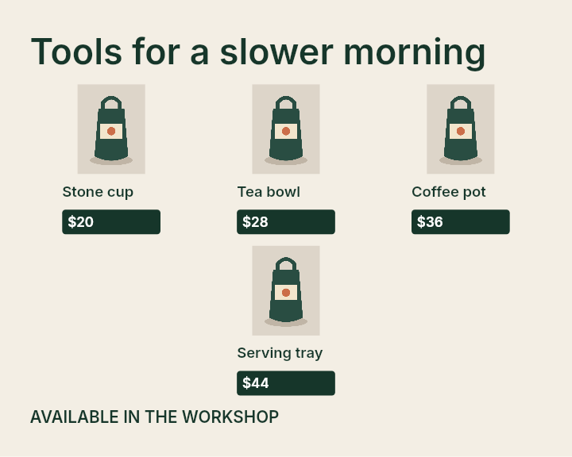
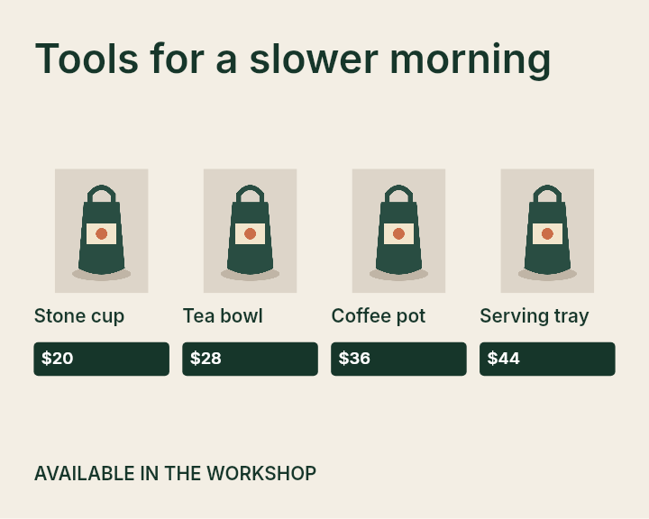
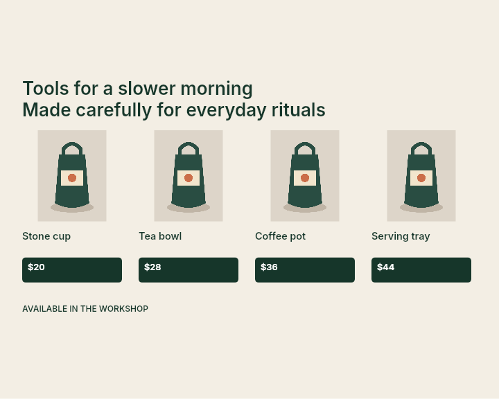
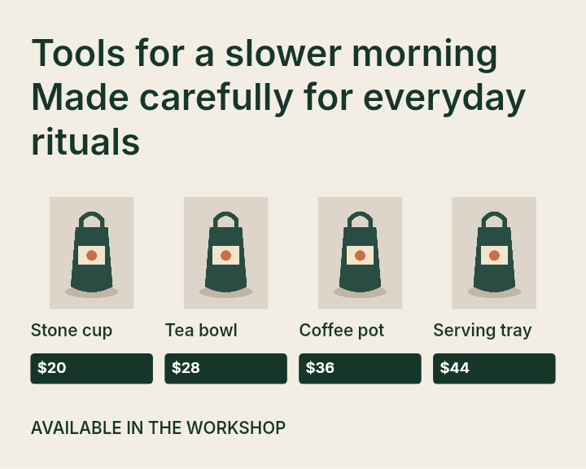

# Four-product transition review — September 22, 2026

This is a bounded issue [#12](https://github.com/kj-squared-labs/reflow-studio/issues/12) engine correction from base `63393d5`. The [plan](../../plans/grid-transition-review.md) defined the diagnosis and acceptance checks before code edits. All designs here are authored development fixtures; this is not an independent human quality result.

## Failure and decision

On the four-product shelf, 1350×1080 selected a readable single row. At 1351×1080, the 1.25 aspect cutoff removed that candidate. The selector then chose a three-column, 3+1 grid, moving the last product into a second row. The normalized maximum adjacent element-center movement was **0.39295**. On the valid long-headline variant, the same boundary selected a letterboxed uniform layout with five small-text warnings. The row was absent from the generated set at 1351, so this was a **missing-candidate** failure, not evidence for changing ranking weights. [All candidates, scores, dimensions and diagnostics](review.json) and the [discovery boundary sweep](baseline-boundaries.json) preserve that distinction.

The upper aspect cutoff is removed. The single row remains available for exactly four eligible explicit product groups when width/height is at least 0.8; the existing source-aware selector chooses among all valid candidates. At 1351×1080 it selects the row with zero hard errors and zero readability warnings for both authored sources. The adjacent movement falls to **0.00015**. For the shorter shelf, its product images are 282×259px versus 232×213px in the previously selected 3+1 candidate. The long-headline case improves from five warnings to zero. Reverting just the newly available row reproduces the earlier selections on those cases. Hard preservation gates, ranking weights, typography, schema and font resources are unchanged.

| Short shelf at 1350×1080 | Old 1351×1080 selection | New 1351×1080 selection |
| --- | --- | --- |
|  |  |  |

| Long-headline old 1351×1080 | Long-headline new 1351×1080 |
| --- | --- |
|  |  |

## Controls and limits

The 1080×1920 story still omits the single row and selects a 3+1 grid with 295×271px product photos, zero hard errors and zero warnings. The 1920×1080 wide format chooses uniform scaling, so extending generation does not force a row when the source layout scores better. All 30 original benchmark selections and complete editable outputs are identical to base; they retain zero hard errors and seven warnings. The same-size and ±1–8px controls pass. A fresh source-aware [sweep summary](stability-summary.json) records 182 nearby observations, zero current rearrangements, maximum 0.00444 normalized movement, and 20 observed broader transitions. Removing the composition term yields 18 nearby rearrangements; this is an ablation of ranking on the same generated candidates, not independent quality evidence.

The discovery sweep found **14** strategy switches in 5px-width sampling plus integer checks inside observed brackets across two four-product designs and product-pairs at three fixed heights. The lower 0.8 gate still creates an approximately **0.394** adjacent movement at 863→864×1080 on the short shelf; the long-headline variant moves 0.363. Removing that lower gate altogether selects the row on the tall story, where visual inspection found markedly smaller photos than the existing 3+1 selection (215×197px versus 295×271px). This lower boundary remains an explicit limitation pending a general quality criterion or better candidates. The sweep is not exhaustive where coarse bracket endpoints share a strategy.

Product art uses `contain` in these controls; the change does not crop these assets. Visibility is supported by the rendered images and existing diagnostics, but the engine has no general pixel-level subject-retention measure. Hierarchy and alignment are source-relative ranking proxies; independent creator judgment remains #7. The [paired native run](review.json) has 144 old/current pairs, one warmup then three alternating rounds: median 25.19→25.15ms and measurement calls 221,103→229,590. Timing is local and noisy; the added eligible row costs measurements without an enforced deadline.

## Test-first and verification

- New behavioral test first: [20 passed / 1 failed](red.txt). The failure was the expected `group-grid-3` at 1351×1080 rather than `group-grid-4`. A wide-layout control was initially overstrict about normalized movement; it was corrected to assert exact baseline selection before the recorded red run.
- Smallest engine change, then [21/21 focused tests](green.txt), [266/266 complete tests](final-test.txt), [build](final-build.txt), [30 native layouts](final-verify.txt), and [benchmark](final-benchmark.txt) passed. [Browser acceptance](browser.txt) passed after installing the missing local Playwright Chromium binary; `/verify.html` reported [12/12 checks](browser-report.json) with no startup errors or glyph-bound findings. Representative before/after native PNGs above were inspected.
- Copy [reproduction helper](reproduce.ts.txt) to `reports/transition-evidence.ts` and [discovery sweep](discovery-sweep.ts.txt) to `reports/transition-review.ts`, then run `npx tsx` on each. The helpers use bundled native fonts and write under ignored `reports/`. `npm run review:stability` regenerates the larger source-aware sweep. The archived [review JSON](review.json) contains per-candidate scores, readability, image dimensions, adjacent movement and paired runtime; generated editable/PNG reports remain under `reports/latest/`.

Issue #12 remains open for the lower-boundary decision, broader transition quality, independent held-out/creator assessment with #7, and real visibility/crop checks with #6. Existing browser and repository verification workflows were sufficient; no new reusable skill was needed.
