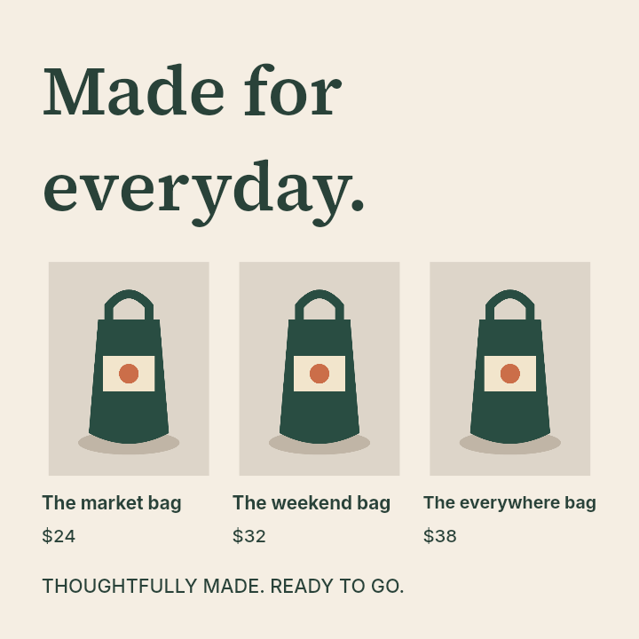

# Measured whole-group product layouts — September 22, 2026

Bounded engine slice of [#5](https://github.com/kj-squared-labs/reflow-studio/issues/5). [Plan and red/green record](../../plans/ci-parity-and-product-grid.md) · [all nine product candidate sheets](gallery.md) · [complete 45-case comparison, ablation, runtime and code/font hashes](review.json.gz) · [all 30 standard benchmark results](benchmark-results.json.gz).

These are authored synthetic development cases and agent visual observations. There is no independent corpus, blind human preference result, or Adobe certification. #5 stays open, including teammate review.

## Result

The square `product-pairs` layout moves from uniform scaling to a three-column whole-group grid. Its **six label/price warnings and one footer warning become zero**, with no copy, asset, style, paint-order, group-membership or group-geometry loss. The headline retains greater prominence than the labels. Text uses the newly verified native measurements and existing fit clearance; thresholds and ranking weights are unchanged.



The generator first reserves measured height for text above/below a product band, then tries 1–3 columns of rigid groups. It supports 2–6 explicit image/text groups and up to four text bookends. Ambiguous associations, cross-group overlaps, sidebar text and unrelated decoration retain the original alternatives. Existing layered price backings remain attached. See [precise eligibility](../../design-contract.md#whole-product-group-grids).

## Original 30-case comparison

| Diagnostic | Before (`36b31fa`) | After |
| --- | ---: | ---: |
| Source / baseline / selected errors | 0 / 0 / 0 | 0 / 0 / 0 |
| Baseline warnings | 45 | 45 |
| Selected warnings | 14 | 7 |
| Square product warnings | 7 | 0 |
| Story product warnings | 0 | 0 |
| Unchanged editable documents / PNGs | — | 68 / 70 of each |

Only square and story product selections change: square `uniform → group-grid-3`, story `split → group-grid-3`. Landscape products and all nine other designs retain identical selected documents and PNGs. Selections: identity 1, uniform 17, stack 10, split 0, three-column grid 2. Baseline/legacy alternatives and diagnostics compare exactly against the previous engine on all **45** review cases. Removing only new grids restores every previous selection, including all warning counts. No ranker/model change contributes to this result.

The one- and two-column square alternatives retain six small-text warnings each. The full standard run adds nine candidates (97 total). The 45-case review adds 27 (160 total); no new grid duplicates were emitted. Native/browser original arrow warnings remain, as do four unrelated small-text warnings. All source strings are unchanged.

## Generation versus ranking observations

Each of the nine sheets retains the previous selection and every current candidate, not just the winning output. Agent visual review found:

| Development case | Observation | Remaining work |
| --- | --- | --- |
| Three products / square | Old candidates all have small labels; the new three-column option visibly enlarges labels/footer and keeps each image association. | Bounded generation improvement; independent human acceptance still needed. |
| Three products / story | Both two- and three-column grids are readable; the ranker selects the sparse three-column row. Two columns give larger product images and use more of the tall canvas. | Ranking/whitespace tradeoff, not absence of an alternative. No claim that selected is aesthetically best. |
| Four products with price plates / square and story | Two-column grids are readable and balanced. The ranker picks three-plus-one, preserving more horizontal source arrangement but leaving an uneven last row. | Another candidate-selection tradeoff for future independent review. White prices remain on their dark backing. |
| Four products with long headline / square | Reserving the four-line headline leaves every candidate with small product text; selected remains the previous split with eight warnings. | Generation/space-allocation limitation. Rigid groups cannot redistribute image/text space internally; no warning is hidden. |
| Four products with long headline / landscape | A feasible grid reduces eight selected warnings to zero. | Readable development result, not independent quality acceptance. |
| Sparse, layered and healthy nearby controls | All original sparse/layered outputs remain unchanged. None of 56 healthy nearby observations rearranges. | Global size continuity remains unproven. Four nearby resizes of the deliberately overflowing long-headline source rearrange to remove an existing clipping error. |

The long-headline control deliberately retains its original short source title box after adding copy, so its uniform candidate has one pre-existing clipping error in each target. Those three failures remain visible in `review.json.gz`; no new grid has a detected hard error. All original benchmark candidates have zero hard errors.

## Runtime and limits

Node 24.20.0, macOS arm64, native Skia/font dependencies from the lockfile. One warmup per engine/case, then three paired rounds alternating order:

| Set | Paired observations | Before median | After median | Native measurement calls, before → after |
| --- | ---: | ---: | ---: | ---: |
| Original 30 targets | 90 | 15.96 ms | 15.95 ms | 69,798 → 80,085 |
| Three product development designs × three targets | 27 | 21.10 ms | 43.90 ms | 31,428 → 65,340 |

The aggregate median masks the cost on eligible designs: product generation roughly doubles local layout time in this run. This is a bounded candidate count, **not** a runtime deadline or process-memory limit. Existing per-call measurement caching and equivalent stack/split reuse remain covered by their tests. #8's execution/container/official-limit work remains open.

## Tests and rendered evidence

- Initial regressions: [3 expected failures / 5 controls passing](red.txt). [Caller mutation](alias-red.txt) then exposed shared bookend objects, which were fixed with per-candidate clones.
- **253 tests** pass; build, 30 native verification cases and the benchmark pass. The preservation suite now exercises all seven strategy identifiers without weakening any preservation assertions.
- [Browser report](browser-report.json): **12/12**, all 150 native/browser line-break probes agree, no glyph-bound/startup errors. [Native reference](native-metrics.json) and [browser runtime](browser-runtime.json) retained.
- Final engine fault controls also fail as intended: [badge separation](badge-fault.json) and [font mismatch](parity-fault.json) each fail exactly their targeted real assertion (11/12); removing the fault restores 12/12.
- Native sheets for all nine eligible review cases inspected, including legal white-price/dark-plate overlap; sparse output unchanged and inspected. [Product workbench](images/browser-products.png) strategy labels and baseline/selected toggle visually checked. Manual keyboard/mobile/accessibility and native Adobe checks remain outside this run.
- The preceding [CI prerequisite repair](../2026-09-22-ci-parity/README.md) has hosted success and both actual fault controls. Final engine publication is checked through the Actions run linked in the task handoff.

## Reproduce and ownership

```sh
npm test
npm run build
npm run verify
npm run benchmark
npm run review:products
PLAYWRIGHT_BROWSERS_PATH=.cache/ms-playwright npm run verify:browser
```

`review:products` requires base commit `36b31fa73ea0cc80d1e24a43ef9b67e433e84a92` locally. Fresh output stays under `reports/`; this reviewed snapshot is separate. Its source/font/lockfile hashes identify the implementation used before the publication commit was created.

JD owns the engine and CI changes. Minimal additive strategy labels/counts keep the existing workbench and report consumers working; typography/rendering/resource/corpus behavior was not edited. A typed rigid-versus-reflowable relationship contract, internal product rearrangement, broader anchored/variable-split search, blind corpus review, and teammate hierarchy/usability feedback remain open. No collaborator review or message is claimed. Existing skills and repository review scripts cover the repeatable workflow; no new skill was warranted.

Large JSON archives are stored losslessly as gzip. Read with `gzip -dc review.json.gz` (or `benchmark-results.json.gz`); generated runtime reports still use plain JSON.
