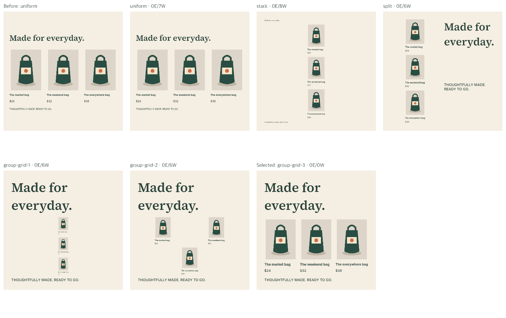
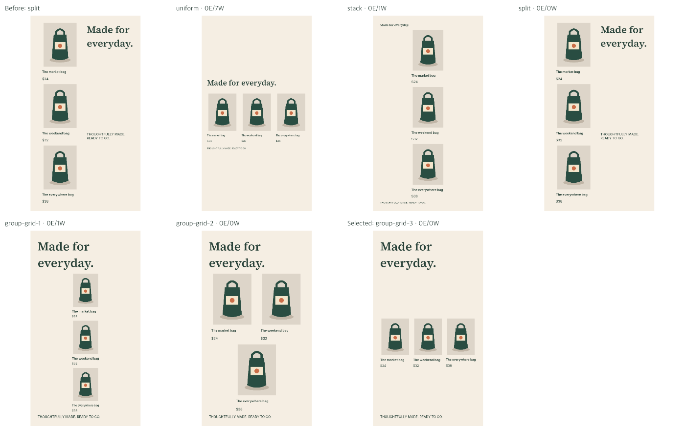
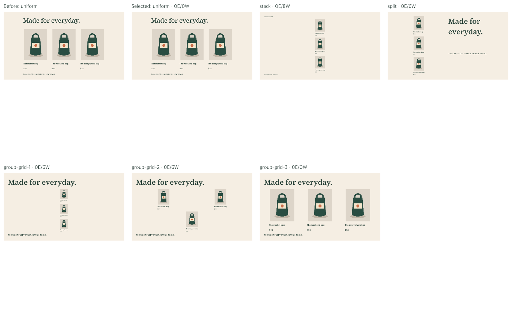
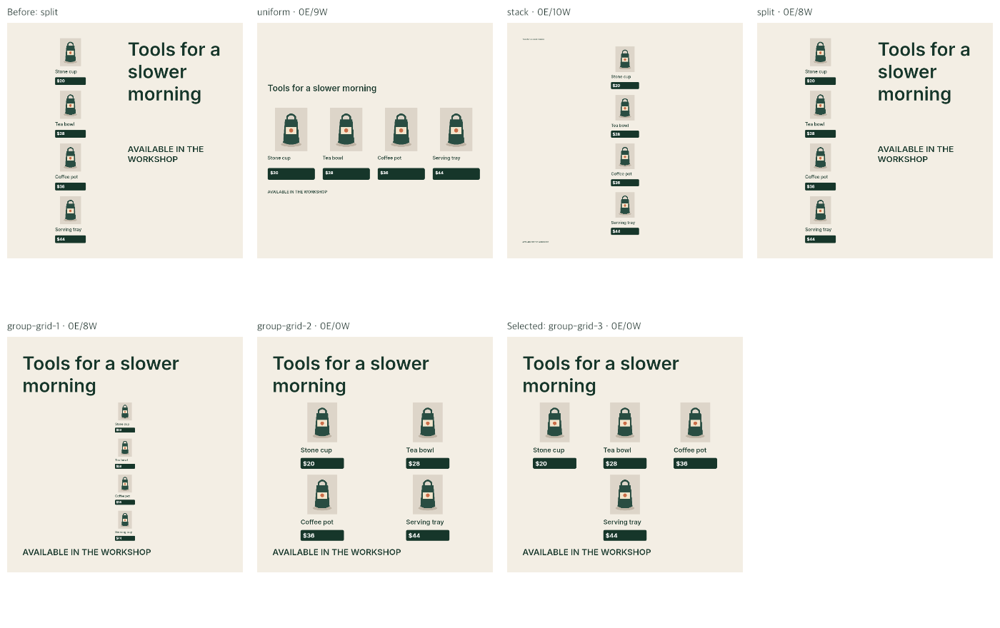
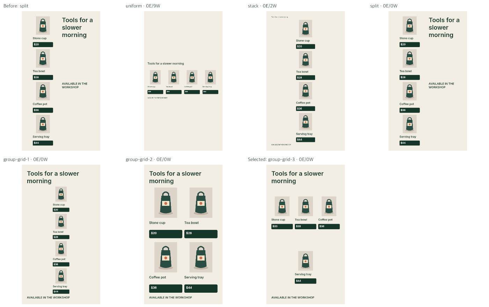
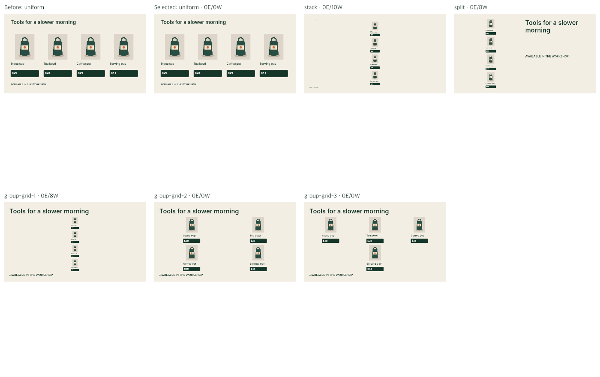
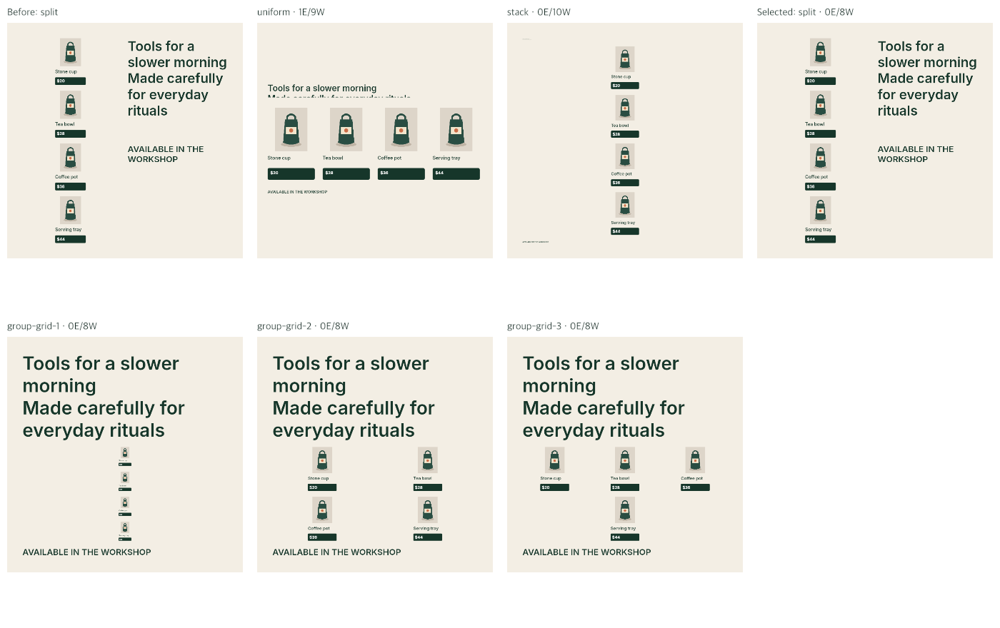
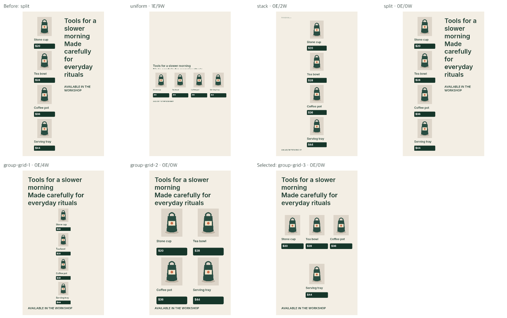
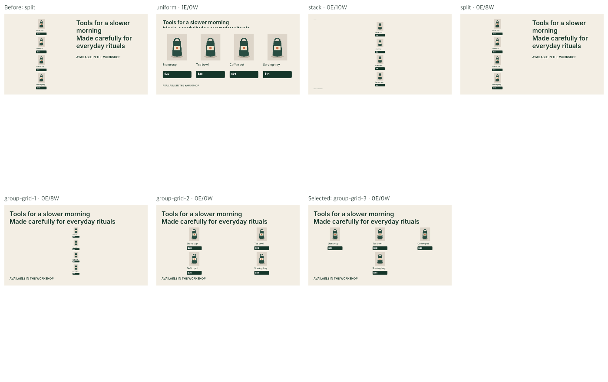

# All product alternatives

Synthetic development evidence; E/W are internal errors/warnings. The first panel is the previous selected layout; subsequent panels retain every generated candidate.

## product-pairs / square

## product-pairs / story

## product-pairs / landscape

## four-product-shelf / square

## four-product-shelf / story

## four-product-shelf / landscape

## four-products-long-headline / square

## four-products-long-headline / story

## four-products-long-headline / landscape

