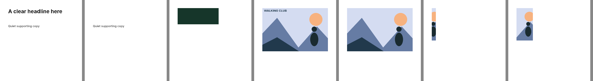

# Rendering #6: shared focal crops and intended layering versus defects

Recorded September 24, 2026. Plan: [focal-crop-and-layering.md](../../plans/focal-crop-and-layering.md). Issue: [#6](https://github.com/ojedaJD/reflow-studio/issues/6). Base commit: `3d08dd9`.

These are development measurements from one machine and one browser. They show that the two renderers draw the same crop and that the new diagnostics separate injected defects from legal layering on authored cases. They do not establish subject retention for real photographs, aesthetic quality, or Adobe integration.

## Environment

| | |
| --- | --- |
| Browser | HeadlessChrome 153.0.8010.12 (Chromium, macOS), via `npm run verify:browser` |
| Node | v22.23.2, darwin arm64 |
| Native renderer | `@napi-rs/canvas` 1.0.9 (Skia) |

## What was wrong

1. **Focal points were quantized to three positions, separately in each renderer.** In a 1:3 cover frame, the `edge-subject` figure (focal x 0.83) snapped to `xMax`. The native PNG showed sky (`212,220,241`) where the figure's head belongs (`red-tests.txt`, first failure).
2. **Occlusion ignored paint order and non-content roles.** An opaque decoration moved over a headline produced no finding. The full-canvas cover fault was caught only as an inventory change.
3. **Any source overlap exempted any output overlap**, however much it grew.
4. **Visible contrast was unchecked.** A white label moved off its dark plate onto white canvas produced no finding unless a group relationship happened to exist.

## What changed

| Area | Change |
| --- | --- |
| `src/crop.ts` | `cropGeometry` (continuous `object-position` semantics, uniform scale) and `assetSize` (SVG/PNG data URI dimensions, no I/O) |
| `src/render.ts`, `scripts/native.ts` | Both draw the shared drawn rectangle under the element clip. SVG falls back to the nearest alignment when the asset size is unknown. |
| `src/visibility.ts` | Deterministic sampling over text line boxes, shapes and visible image regions; paint-order obstruction; WCAG contrast against the composited backing |
| `src/evaluate.ts`, `src/model.ts` | Additive `occlusion` and `low-contrast` errors and a `crop-loss` warning, all relative to the source; stricter collision exemption; optional `resources` argument |
| `scripts/crop-parity.ts`, `tests/browser-checks.ts` | Native pixel reference and a browser SVG comparison with a `crop-mismatch` fault control |

## Results

### Crop parity across renderers

**18 of 18 hand-derived samples agree** between Chromium SVG, native PNG and the colours read from the asset source. They cover three probes: cover with focal x 0.83, contain with focal x 0.25, and cover with focal y 0.27. The samples include features inside each crop and points 4px outside every frame edge, which confirms the clip ([`browser-report.json`](browser-report.json), [`native-samples.json`](native-samples.json)). The archived `browser-report.json` is the final phase 2 run, with 14/14 checks.

The negative control injects the old quantized `xMax` focal point in the browser only. It fails exactly the four in-image samples of the edge-subject probe, while its out-of-frame samples still agree ([`browser-report-fault-crop-mismatch.json`](browser-report-fault-crop-mismatch.json), 12/13 checks at the time).

### Diagnostics: injected defects versus positive controls

`tests/visibility.test.ts` pairs every defect with a legal counterpart:

| Defect (reported) | Legal counterpart (clean) |
| --- | --- |
| Opaque decoration moved over a headline → `occlusion` | Same decoration kept clear at four sizes |
| Slight source overlap grown to most of the line → `occlusion` | Same slight overlap under uniform scaling |
| Full-canvas decorative cover → `occlusion` for every content element | — |
| 80% opacity veil moved over text → `occlusion` | Translucent ellipse behind text; unchanged 20% tint over text |
| Image moved over earlier-painted text → `occlusion` | — |
| White label off its plate → `low-contrast`, also when grouped | Label on its plate at nearby and extreme ratios |
| Label half off a 60% translucent plate → `low-contrast` | Already-faint source kept faint |
| Caption overlap with a photo grown from 11% to 100% → `collision` | `intentional-overlap` fixture at all three targets |
| 1:4 cover frame of a 3:2 image → `crop-loss` warning (17%) | Same-aspect frame; `contain` |

The positive-control sweep covers 10 fixtures and 3 grouped designs across 3 targets, nearby sizes (+1/−8 px) and 1440×480 and 420×1600. No selected output reports `occlusion` or `low-contrast`.

The adversarial fault injections ([`adversarial-probes.json`](adversarial-probes.json)) now also carry visible-result findings alongside the structural ones:

- The full cover reports 7 `occlusion` findings.
- The zero-opacity headline and the magenta brand colour each report `low-contrast`. `#ff00ff` on `#f3f0e5` is below 3:1.
- Reversed paint order reports the ticket label hidden under its backing.

### Benchmark impact

See [`benchmark-comparison.json`](benchmark-comparison.json).

- **Selections unchanged in all 30 cases.** Selected errors remain 0.
- Selected warnings went from 7 to 8. The added warning is `crop-loss` on `after-dark`/landscape (`stack`): the wide banner keeps 44% of the source-visible artwork ([image](images/after-dark-landscape-crop-loss.png)). That is a real geometric crop, and it is reported rather than hidden.
- Other `crop-loss` warnings appear only on unselected `stack`/`split` candidates (16–48%).
- No candidate in any case reports `occlusion` or `low-contrast`.
- **Changed images:** only `edge-subject` (source, and baseline/selected at all three targets). Its focal point, 0.83/0.55, is no longer snapped to 1/0.5, so the figure moves in from the crop edge ([before/after](images/edge-subject-before-after.png): before is panels 1 and 3, after is panels 2 and 4).
- **Runtime:** three benchmark runs each on this machine. Median layout went from 12.4–12.7 ms to 14.5–14.7 ms, and p95 from 31.0–31.7 ms to 37–42 ms. This is a local observation, not a budget.

## Phase 2: rendered verification, regions and the defect-control pack

Phase 1 diagnostics are geometric proxies. Phase 2 adds three things:

- **Rendered pixel measurement** (`src/rendered-visibility.ts`), sharing no code with the geometric sampling. For one element, core pixels are where the element alone renders the same over black and white. Text is drawn in fixed black ink at its full laid-out height, because Skia's glyph antialiasing gamma varies with colour and moved core counts by about 14% in the first test run. A text core pixel counts as legible at ≥ 3:1 contrast between the full render and the render without the element. Other core pixels count as visible when they differ by ≥ 32. A drop of more than 0.10 against the source is a defect, and fewer than 20 core pixels gives no verdict.
- **A `region` on every occlusion, contrast, collision and crop finding.**
- **An author-labelled pack** in [`defect-pack/labels.json`](defect-pack/labels.json), with source/output PNG and JSON per case. It has 24 cases: 12 defects and 12 legal controls.
  - Defects: occlusion ×4, paint order, opacity, contrast ×2, contrast over imagery, clipping, subject crop and glyph.
  - Four of the defects are attractive-looking corruptions: a camouflaged cover, a transparent label, a caption in a matching photo region, and a label moved off its plate.
  - Legal controls: overlays, transparency, a faint-by-design source, a narrow crop that keeps the subject, and three engine-selected fixture outputs.
  - Frozen with it: engine commit `e10c973`, `@napi-rs/canvas@1.0.9`, `@fontsource` 5.3.0 font file hashes and asset hashes.

Panels, left to right: the camouflaged-cover source and output (the headline is gone, and the result looks clean); the transparent label on its plate; the caption on sky (source) and the caption lost in the matching foreground (output); a 1:8 crop that cuts the figure; a 1:2 crop that keeps it.

| Evidence | Result |
| --- | --- |
| Native rendered verdict vs author label | 23/23 measured cases agree; the glyph case is evaluator-only |
| Browser (Chromium SVG with embedded bundled fonts) vs native verdict | 23/23 agree; largest share difference 0.009 across 32 element pairs ([`browser-report.json`](browser-report.json), 14/14 checks) |
| `rendered-mismatch` fault control | Fails exactly `label-off-plate` ([`browser-report-fault-rendered-mismatch.json`](browser-report-fault-rendered-mismatch.json), 13/14) |
| Hosted CI (Ubuntu, Linux Chromium) | Push run [35959617763](https://github.com/ojedaJD/reflow-studio/actions/runs/35959617763) on `4d454ef` passed both jobs; dispatch `rendered-mismatch` run [35959779869](https://github.com/ojedaJD/reflow-studio/actions/runs/35959779869) failed at `label-off-plate`, as intended |
| Geometric evaluator vs author label | 22/24 agree; 2 disagreements listed in the pack |

Both disagreements are known limits, recorded rather than tuned away:

- `caption-onto-matching-photo-region`: dark text moves onto a same-coloured part of a photo. The evaluator reports nothing, because image backings have no geometric contrast verdict and the overlap share is unchanged. The rendered check reports legibility falling from 1.00 to 0.00.
- `subject-kept-narrow-crop`: the evaluator's `crop-loss` warning fires on a 1:2 frame that keeps the whole figure, because it measures retained region, not subject. The rendered subject pixels are unchanged.

Red evidence ([`red-tests-phase2.txt`](red-tests-phase2.txt)): the region test failed because findings had no region. The rendered and pack test files failed on missing modules, since they are new APIs with no prior behaviour. Their behavioural motivation is the evaluator gap above, which the passing tests now assert explicitly.

After phase 2 the test suite has 406 passing tests; the build and verify pass. The benchmark has 0 selection changes against `3d08dd9`, 0 selected errors and 8 selected warnings.

**#4 official/native path:** not available. #4 is still open and has no native Express round trip, so none of these cases has been validated through the official renderer. Only the local SVG (Chromium) and native PNG (Skia) renderers are covered.

## Approximation limits

- Text is sampled over laid-out line boxes, not glyph ink. Covering the empty part of a line box counts as obstruction.
- In the geometric evaluator, images count as opaque inside their drawn region, and text over an image gets no contrast verdict. The rendered check covers that case on pixels, but it is verification and the defect pack's evidence, not a selection-time finding.
- The rendered check depends on the inspection raster (at most 720×900). Text below about 9 rasterized pixels has no core pixels and gets no verdict, never a pass.
- Thresholds are provisional engineering values, not calibrated perception: +0.10 obstruction, −0.10 legible share at 3:1, +0.10 overlap share, and a crop that retains under 50% of the source-visible region.
- `crop-loss` measures the region retained, not the subject. The schema has no subject box, so the focal point is the only declared subject evidence. It is always visible under cover by construction.
- Asset sizes are read only from SVG and PNG data URIs. Any other URI keeps the previous nearest-alignment SVG crop and skips crop diagnostics.
- `review:stability-runtime` already fails on `3d08dd9`, before this change. It compares against an engine from before product grids and asserts identical candidates.

Hashes of the archived files are in [`hashes.txt`](hashes.txt).
