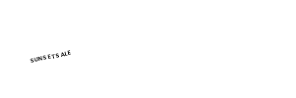

# Small-text spacing: macOS/Linux advance-policy evidence

Candidate `83095a0e99ff6dc75c28ba4a86a9f660c9889aa1` was executed on
macOS arm64 and [Ubuntu CI run 38765125773](https://github.com/kj-squared-labs/reflow-studio/actions/runs/38765125773).
The hosted Python job passed 438 tests without skips; macOS's verifier also
reported 438/438. JavaScript tests passed 704/704 and the local build passed.
The local shell wrapper failed after Python completed because it assigned zsh's
reserved `status` variable; this is recorded separately from the test result.

The 50 matched rows use identical design JSON, font bytes, diagnostic script and
renderer text implementation. All 50 default glyph-advance arrays and PNG hashes
differ between platforms. Linux default advances are integer-valued; macOS
advances are fractional. In the separate metric probe, Linux linear-metrics or
unhinted policy approaches macOS defaults (maximum linear delta 0.000107 px).
Subpixel positioning alone leaves the Linux default advances unchanged. For
SUNSET SALE at 6 px, Linux advances begin 5,4,5 while macOS begins 3.69,4.23,4.512.
Both platforms retain all 20 fractional/integer PNG identity controls.

This isolates a platform-dependent advance policy, not a complete causal proof
of every visible gap. The official renderer was never modified, and alternate
metric-policy values are not alternate rendered outputs. A uniform tracking
adjustment cannot exactly cancel the nonconstant per-glyph advance differences.
Increasing the floor is not justified without preserving full layout constraints
and actual Linux before/after checks. The next policy question is whether the
official renderer permits font hinting/linear-metrics configuration; no upstream
patch or organizer communication is made by this evidence packet.

`comparison.json` binds paired measurements. Each platform diagnosis records
versions, source/font hashes, font events and limitations. The two ZIPs preserve
all 50 input JSONs, 50 original PNGs and 50 nearest-neighbor 2x views; filenames
match diagnosis entries. Selected rotated label views are also directly visible:

| Platform | 6 px at 2x | 7 px at 2x | 8 px at 2x |
|---|---|---|---|
| macOS |  |  |  |
| Linux |  |  |  |

These images were inspected by AI for diagnostic continuity only. No actual
human 1x/2x readability verdict has been obtained. Issue #148 and parent #3 remain
open; this packet is not an engine fix or public-sample quality acceptance.

The archived reproducer's characterization passed before extraction. The new
probe initially lost borrowed font bytes; its nonzero-glyph/advance regression
failed before retaining the bytes and passed afterward. See the three small
characterization/regression logs. The older archived diagnosis was separately
checked and contains no all-zero advance rows; do not conflate this extraction
bug with the upstream spacing mechanism.
