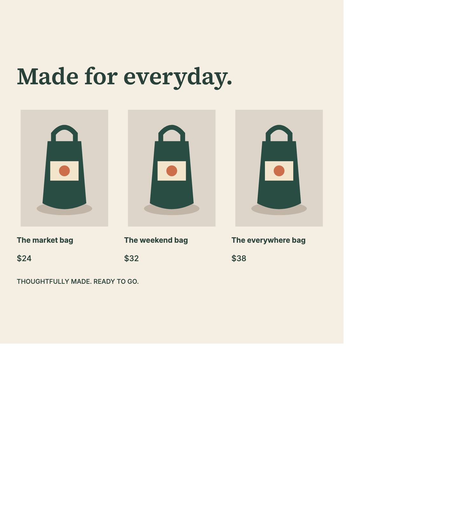
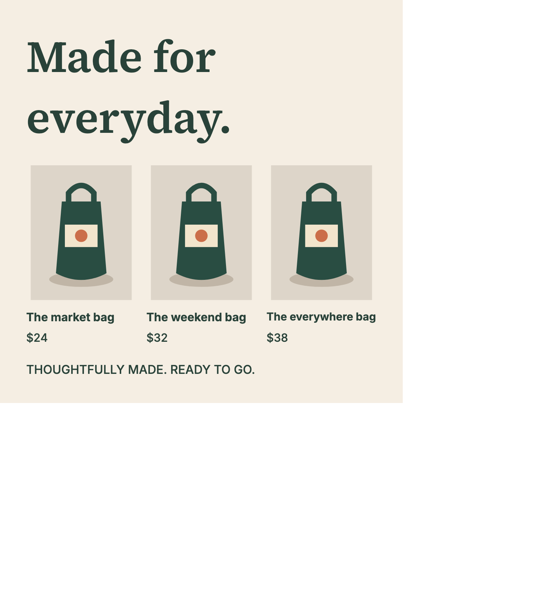

# Offline SVG export evidence — October 15, 2026

Issue [#29](https://github.com/kj-squared-labs/reflow-studio/issues/29), candidate `a59cc2bd714dc6c14c061334fc28905765e00e4c`, based on `8ac29a0103bdb8c092c59ab88160a5a58952181a`. [Plan](../../plans/two-hour-C-export.md). This snapshot records the focused candidate; full integrated validation and publication are separate gates.

The actual card download embeds only used bundled font faces/subsets. The renderer, layout engine, original text, images, element order and styles are unchanged. Unsupported/missing resources produce a visible error and no download. An asynchronous export retains the clicked design and filename even if another fixture is selected while fonts load.

**Visible limitation:** the default `after-dark` sample contains right-arrow U+2192, outside bundled Inter's declared coverage. It now refuses SVG export with an error naming the font/glyph, rather than relying on a system fallback. Switching to a supported design recovers. No font was added and source text was not rewritten. The bundled coverage declarations are a proxy, not a complete cmap/complex-script certification. Chromium standalone SVG is tested; other SVG consumers are not qualified.

## Evidence

- [Supported baseline RED](supported-red.log): an actual `type-pairing` UI download preserved text and made no network requests, but its offline first-line width was 515.297px versus 500.331px in the thumbnail preview. [Original deficient SVG](supported-red.svg) has no embedded font bytes. After correcting the comparison to use identical intrinsic SVG scale, the final regression requires 0.005px agreement, without weakening the original font-fallback diagnosis.
- [Filename-race RED](filename-race-red.log): delaying font loading and switching fixtures named the old artwork with the new fixture ID before the fix.
- [Focused browser GREEN](focused-green.log): **13 passed, zero failures/skips**. Actual Original/baseline/selected downloads reopen in fresh contexts with every external request blocked and no app CSS. Text, element order, image data and glyph bounds agree; exported ON/OFF overlay artwork is identical. Removing embedded images changes rendered pixels. Five family/weight controls exercise Latin, extended Latin, Greek, Cyrillic and Vietnamese; every embedded face is independently hashed against the bundled font file. Missing declarations/assets, HTTP404, invalid font bytes and unsupported glyph controls fail visibly; recovery and delayed-filename tests pass.
- [Focused unit GREEN](unit-green.log): **8 passed, zero failures/skips**. Resource selection, deduplication, unsupported content, missing resources and no-text cases are covered. Unit font loading is stubbed; the browser tests decode actual bytes.
- [Resource inventory](inventory.json) retains all nine matrix download hashes, byte sizes and individual face hashes. Product baseline/selected downloads are **100,762 / 100,876 bytes**, containing exactly three Latin faces: Inter500, Inter700, Source Serif4 600. Each Unicode matrix download contains exactly five relevant subsets of its single family/weight; no other weight is embedded. Network request lists are empty.
- [Artifact manifest](manifest.json) binds the retained files. Log copies replace only the local worktree path with `<repo>`; original generated-log hashes are retained separately. Temporary test-run paths are diagnostic artifacts, not source dependencies.

Representative actual downloads: [Original SVG](original.svg), [baseline SVG](baseline.svg), [selected SVG](selected.svg), [Inter Unicode SVG](unicode-inter.svg), [Serif Unicode SVG](unicode-serif.svg). Their PNGs were inspected by AI for visible assets/glyphs; this is technical inspection, not independent human quality acceptance.





## Reproduce

From the candidate checkout using its lockfile and supported Node version:

```sh
npm ci
npx playwright install chromium --only-shell
npx tsx --test tests/svg-export.test.ts
npx playwright test tests/browser/svg-export.spec.ts --output /tmp/reflow-svg-export-results
npx tsc --noEmit
```

The tests write fresh reproducible files to `reports/two-hour/C/`. The explicit output directory keeps Playwright's failure-trace HTML out of Vite's watched repository. Use the repository's full npm/build/verify/benchmark/browser gates for integrated acceptance. Those results are not inferred from the focused checks here.

## RF04 boundary

[RF04 disposition](rf04-disposition.json) preserves all **21** historical task identities and task hashes. This lane found only the current preflight tool, without an established ready accepted-input/executor binding. No RF04 execution, source transfer, baseline/engine comparison, human judgments, native Adobe integration or issue closure is claimed. Three historically accepted source conversions remain distinct from the three further sources required by #112.
